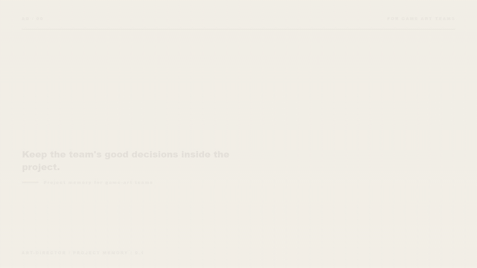

<p align="right"><a href="README.md">中文</a> · <strong>English</strong></p>

<picture>
  <source media="(prefers-reduced-motion: reduce)" srcset="assets/readme/art-director-still-en.png">
  
</picture>

# Art Director

> **What the director already corrected should not be guessed again.**

Art Director keeps the decisions a game-art director and team have already confirmed. It records why a reference matters, what must stay recognizable, what this round should change, and how the asset must be delivered. A new teammate, agent, or session can start from there.

It works for a world-heavy project that must hold a distinct mood and for a casual game producing characters, environments, tiles, props, UI, and effects every week. A simple style can still be hard to coordinate. As the asset count and team grow, small drift turns into expensive rework.

The director still decides what looks right. Art Director remembers those decisions, carries them into each brief, and leaves useful evidence for the next round.

`Codex` · `Claude Code` · `Cursor` · other Agent Skills-compatible tools

## Install

```sh
npx skills add https://github.com/NewenergyEric/art-director-skill
```

The core CLI needs Python 3.10+ and no third-party packages. Pillow is optional and used only for pixel-level image checks.

Then ask:

> Use `$art-director`. Start with the references this project has already confirmed and the latest review notes. Record style, character or prop identity, this round’s task, and technical requirements separately, then build a project pack the team can keep using.

[Open the full call flow](docs/call-flow.html) · [Read the skill entrypoint](SKILL.md) · [Explore the Moss Harbor sample](examples/moss-harbor-draft)

---

## More assets create more ways to drift

Reference folders grow, but the team may no longer know which image sets the style and which one defines a character. A director corrects the same issue for three rounds, then a new teammate or agent starts again from a vague prompt. Casual and match-3 teams may be producing characters, tiles, props, UI, effects, and outsourced batches at the same time. Drift in one lane can multiply into a full batch of rework.

Art Director keeps four kinds of decisions separate:

| Layer | What it owns | How it enters production |
|---|---|---|
| **Project style** | Global intent, colour, material, and cross-category rules | Inherited by every task |
| **Entity identity** | Features a character, prop, or environment must retain | Bound only to that entity |
| **Task variation** | Pose, expression, camera, and use | Scoped to the current brief |
| **Technical facts** | Size, alpha, format, and platform conditions | Checked from real files |

One style can contain many characters. One character can take many poses. Once the four layers are separate, the team can see what this round may change, what has already been confirmed, and what still needs the director’s judgement.

## How it works with the team

1. **Look at the work already there**: bring together original files, approved samples, current guidance, and recent review notes. Mark what is reliable and what is missing.
2. **Say what needs to change**: turn “it feels wrong” into a specific object, area, reason, and allowed adjustment.
3. **Leave a project pack behind**: keep current decisions in `style-pack.json`, then generate a readable `STYLE.md` and a callable `SKILL.md`.
4. **Brief each production lane**: characters, environments, tiles, props, UI, and effects receive the rules they need without inheriting another asset’s identity.
5. **Review a small batch first**: confirm the direction with a few representative assets before scaling production. Keep technical checks and art judgement separate.
6. **Carry the work forward**: when the direction changes, preserve the old version, describe the change, and hand the confirmed baseline to the team.

## Run a real command

The repository includes a fictional Moss Harbor draft. It intentionally contains missing references, proposed rules, and unverified tools so the workflow can show how it behaves when evidence is incomplete.

```sh
python scripts/style_pack.py validate examples/moss-harbor-draft

python scripts/style_pack.py brief examples/moss-harbor-draft \
  --category character \
  --entity lin \
  --task "Lin repairs a lantern on the dock"
```

Start a new project from the template:

```sh
copy templates\style-pack.template.json my-project\style-pack.json
python scripts/style_pack.py render my-project
python scripts/style_pack.py build my-project --out dist/my-project-0.1.0
python scripts/style_pack.py verify dist/my-project-0.1.0
```

On macOS or Linux, replace `copy` with `cp`. Add `--release` to `validate` and `build` when publishing a confirmed baseline. Release checks stop and name the gap when evidence or referenced files are missing.

## The deliverable is more than a prompt

```text
project-art-style/
├── SKILL.md          # entrypoint for a new session
├── STYLE.md          # human-readable direction
├── style-pack.json   # single source of truth
├── manifest.json     # file inventory and content hashes
├── references/       # approved, shareable source material
├── scripts/          # validation and brief tooling
└── agents/           # agent UI metadata
```

The pack can be copied, archived, and verified. A teammate does not need the director’s original chat history to understand the version, scope, confirmed decisions, and questions that still need judgement.

## Two local tools

### `style_pack.py` · pack lifecycle

`validate`, `render`, `build`, `brief`, `verify`, `archive`, and `diff` cover the path from a working copy to an immutable release snapshot. Core commands use only the Python standard library and refuse to overwrite existing builds or archives by default.

### `pilot.py` · source intake and pilot evidence

`intake` inventories real source material, `check-image` reads dimensions and alpha information from actual pixels, and `summarize` keeps agent simulation separate from human-team A/B records. It does not generate images or pass technical validity off as art approval.

## What is verified

- Automated tests cover schema rules, cross-references, path boundaries, case collisions, overwrite refusal, relocatable builds, and content hashes.
- Independent scenarios cover tool-free fallback, review from a standalone project pack, and a discussion draft built from ambiguous intent.
- Core scripts run on Python 3.10+; pixel checks activate when Pillow is installed.
- See the [validation report](docs/validation-report.md) and [round-one pilot readiness](docs/round-01-report.md) for the full record.

A valid structure proves that files and records satisfy the contract. Real style consistency, engine readiness, and team efficiency still require approved project samples and use by the team.

## Repository structure

```text
├── SKILL.md              # mother-skill entrypoint
├── agents/               # UI metadata
├── references/           # task-specific methods
├── templates/            # pack, brief, and review templates
├── scripts/              # pack and pilot CLI
├── examples/             # fictional sample project
├── tests/                # deterministic tests
├── evals/                # behavioural checks and pilot records
├── docs/                 # contracts, research, and validation notes
└── assets/readme/        # README visuals and reproducible renderer
```

## Current boundaries

- It does not include an image model, LoRA, or paid generation service.
- It does not infer authorization from a prompt, filename, or typed approver field.
- It does not hide identity errors, technical failure, or unchecked work inside one score.
- It does not declare concept art engine-ready from appearance alone.

Built by Eric with agents. The repository keeps a method the team can use again, rather than the residue of one conversation.
