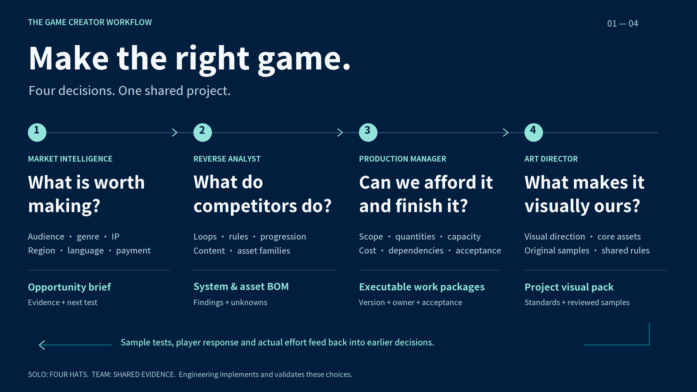

<p align="right"><strong>English</strong> · <a href="README.zh.md">中文</a></p>

[**Game Dev Skills**](https://github.com/NewenergyEric/NewenergyEric/blob/main/GAME-DEV-SKILLS.en.md) · [Market Intelligence](https://github.com/NewenergyEric/game-market-intelligence) · [Reverse Analyst](https://github.com/NewenergyEric/game-reverse-analyst) · [Production Manager](https://github.com/NewenergyEric/game-production-manager) · **Art Director**

# Art Director

### One team, one visual memory.

Shared art direction for people and agents making the same game.

## A story about an art-director friend

Of everyone I know, he is one of the people I would most readily call an artist.

In games, a lot of conversations are about pipelines, tools and efficiency. He talks about how a group of people can speak to one another through something they make. He cares about that elusive thing: how it feels.

For a while, we met often for meals or coffee. Whenever work came up, he had the same complaint: he had spent another whole day explaining “what we’re trying to make” to a new teammate, an outsourcing partner, or another AI that was becoming better at following instructions and worse at making its own judgments.

I asked him, “Which part actually frustrates you?”

He thought for a moment. “It’s not that their work is bad. It’s that I have to explain everything from the beginning, every time. I finish explaining one version, and then I have to start again with the next. And once making a game becomes pure engineering—processes, parameters, checklists—the artistry, the playfulness, the fun starts to disappear.”

That stayed with me.

I’m a game lover and an FDE—a forward-deployed engineer. My work is about helping people connect the pieces. I realized that his problem had never been his taste. His taste was good. The problem was that **he couldn’t hand it over or reuse it.** It lived in his head, and in those few minutes when he explained it all again.

So we talked some more and did a few interviews. We gradually drew out the judgments behind his work: the references, the samples, what could change and what had to stay. We shaped them into something another person, or even an AI, could work from.

It doesn’t design for him or replace his taste. It gives that “feeling” a form he can pass on.

Later, he actually started using it.

That’s why I made a “visual memory”: to keep an artist’s sensibility from being swallowed by engineering.

— Eric

## What Art Director does

Art Director helps a director establish the visual language, representative samples and requirements for each asset family. Team members and agents receive a versioned project pack with clear assignments and the references they need to produce consistent characters, environments, items and UI. A solo creator can keep the same decisions across sessions.

<a href="https://newenergyeric.github.io/art-director-skill/docs/landing.html#film"><picture>
  <source media="(prefers-reduced-motion: reduce)" srcset="assets/readme/depth-preview-en.jpg?v=human-story-20261013">
  
</picture></a>

<p align="center"><sub>24 seconds: from direction to team delivery · <a href="https://newenergyeric.github.io/art-director-skill/docs/landing.html#film">Watch the clear version</a> · <a href="docs/assets/motion/depth-showcase-en.mp4">Download MP4</a> · <a href="docs/CASE-STUDIES.en.md">Read the case evidence</a></sub></p>

## Install. Then work in your agent.

```sh
npx skills add https://github.com/NewenergyEric/art-director-skill --skill art-director
```

Use a tool that supports Agent Skills, such as Codex, Claude Code or Cursor. Give the agent access to your materials and say:

> Use `$art-director`. Here are our gameplay notes, references, existing work and art-director feedback. Propose the visual direction and make a representative sample. Then help establish the asset and component requirements and package them for the team.

Continue existing direction without rebuilding it. Your agent uses its available generation and editing tools; this Skill does not include an image model.

## Play the samples

### Tidekeeper · Merge and restore


Merge seven item families into repair orders. The **0.5.0 candidate** follows the job from fixing the dock and lighthouse timberwork to fitting the lens, adding oil, lighting the tower and welcoming the supply boat. New items and scene states continue the harbor's existing art direction.

[Play Tidekeeper (Chinese UI)](https://newenergyeric.github.io/art-director-skill/docs/assets/tidekeeper-playable/play.html)

### Duskwood Watch · Explore and defend


Carry your lantern through a hand-painted forest, gather supplies and build defenses for four nights on one map. Moving the light strips dark armor; fuel, items and upgrades shape how you defend the clearing. This is the **0.4.0 draft**, developed from one shared project pack.

[Play Duskwood Watch (Chinese UI)](https://newenergyeric.github.io/art-director-skill/docs/assets/duskwood-watch/index.html)

Both are original browser candidates. Human art-direction approval and production device/engine acceptance remain open. [How the agents used the Skill, what was checked and what remains](docs/AGENT-ART-TEAM.en.md).

<details>
<summary><strong>Tidekeeper's earlier handoff and 0.3.0 layered export</strong></summary>

The earlier handoff established character, workshop, item and UI samples, distributed a pack and started five tasks in a new directory: Alan's pose, workshop restoration, L3/L4 lamps and a new order. This was one agent's relocated-directory self-test.


The first pass did not fully work. The assets carried over, but the UI felt like empty cards. A landscape scene cropped out important windows on a portrait screen. Revisions added order characters, resource icons, repair materials, button states and a portrait adaptation.

<p align="center">
  
  
  
  
</p>


The frozen **0.3.0** package contains 19 artwork files, 27 checked assets and dependencies, and 5 scene recipes. Its Compositor format and relocation checks passed; native Mac opening remains untested. This archive predates the eight-frame repair sequence in 0.4.0.

[Handoff and revisions](docs/TIDEKEEPER-HANDOFF.en.md) · [0.3.0 production evidence](docs/TIDEKEEPER-PRODUCTION.en.md) · [0.3.0 candidate ZIP](docs/assets/tidekeeper-production/tidekeeper-production-0.3.0.zip) · [Earlier visual studies](docs/CASE-STUDIES.en.md)

</details>

## From the director’s decisions to the team’s delivery

1. **Use the existing material.** Draft what each reference contributes and what must stay fixed.
2. **Calibrate with a sample.** Inspect shape, proportion, materials and purpose; revise a specific problem.
3. **Carry the rules into each task.** Teammates receive a project Skill, samples, references, version and delivery requirements.
4. **Check in context.** Review families, display size and combinations; return shared issues to the direction.

The handoff includes five readable guides, a project-specific Skill and the relevant files. It can be distributed as a ZIP. Existing tasks retain their original version; new tasks use the published current pack.

After receiving the director’s **complete project pack**, a teammate can say:

> Extend two levels of this lighting family. Keep the view, light and materials, with clearer upgrade silhouettes. Show the first article, then check it on the board. Record the rules used and the checks still open.

The director can continue:

> This is too realistic: ocean detail distracts from the repair. Simplify the surfaces and background. Keep character identity, hand contact and spatial relationships, then compare the revision.

## Two Skills, one project baseline

| What you need | Entry point | Delivery |
|---|---|---|
| Direction, samples, category rules and acceptance | **art-director** | A portable project pack |
| Continued generation, assembly and delivery | **game-art-production** (optional) | Task dependencies, scene recipes, checks and layered files |

The production Skill consumes the same pack and reports missing assets, changed versions and blocked dependencies. It does not create a second set of art rules. Standard asset delivery works without [Compositor](https://github.com/robbietilton/Compositor); use the optional `.comp` export for layered editing.

```sh
npx skills add https://github.com/NewenergyEric/art-director-skill --skill game-art-production
```

Or [download the production Skill ZIP](https://newenergyeric.github.io/art-director-skill/downloads/game-art-production.zip), then ask:

> Use `$game-art-production` with this complete project pack. Continue repair poses, evening states and arrival effects. Check scale and contact points, then deliver editable layered scenes.

The agent's tools generate images; Compositor edits layers and does not run game animation. [Production Skill](skills/game-art-production/SKILL.md) · [Sample production and checks](docs/AGENT-ART-TEAM.en.md)

<details>
<summary><strong>Project packs, guides and requirements</strong></summary>

Core tools use Python 3.10+ and its standard library; Pillow is optional for pixel checks. You can also [download the current Skill ZIP](https://newenergyeric.github.io/art-director-skill/downloads/art-director.zip?v=human-story-20261013). Installing the general Skill does not grant access to private team materials.

[Human guide](docs/HUMAN-GUIDE.en.md) · [Agent integration](docs/AGENT-GUIDE.en.md) · [Skill reading edition](docs/SKILL.en.md) · [Game-art quality method](references/game-art-quality.md)

[Tidekeeper first-article draft](examples/tidekeeper-draft/style-pack.json) · [Harbor Studio setup example](examples/harbor-studio-draft/guides/00-index.md) · [Campaign design example](examples/campaign-studio-draft/guides/00-index.md)

```sh
python scripts/style_pack.py validate examples/tidekeeper-draft
python scripts/style_pack.py build examples/tidekeeper-draft --out NEW_PACK
```

</details>

<details>
<summary><strong>Validation and limits</strong></summary>

[Current CI](https://github.com/NewenergyEric/art-director-skill/actions) · [Original case evidence](docs/CASE-STUDIES.en.md) · [Workflow acceptance](evals/director-workflow-v0.5/acceptance.md)

File checks do not establish artistic quality; agent observations do not establish director approval. Pack tools run locally. Generation services follow the host’s tools and your authorization.

</details>

[Tell us where you got stuck](https://github.com/NewenergyEric/art-director-skill/issues/new?template=showcase.yml) · [MIT](LICENSE) · [Security](SECURITY.md)

Made by Eric and Agents.

## Four roles. One game worth making.

For a solo creator these are four hats; for a team they are connected responsibilities. Explore what is worth making, what competitors do, the resources it requires, and the original art that defines it.

[How the roles exchange evidence, scope and visual assets](docs/WORKFLOW.en.md) · [Explore all four roles](https://github.com/NewenergyEric/NewenergyEric/blob/main/GAME-DEV-SKILLS.en.md)

| Your question | Start here | Carry forward |
|---|---|---|
| What is worth making? | [Market research](https://github.com/NewenergyEric/game-market-intelligence/blob/main/README.en.md) | Options, sources and validation gaps |
| How does it work? | [Reverse analysis](https://github.com/NewenergyEric/game-reverse-analyst/blob/main/README.en.md) | Rules, implementation evidence and asset BOM |
| Can we scope and deliver it? | [Production planning](https://github.com/NewenergyEric/game-production-manager/blob/main/README.en.md) | SOW, work packages, dependencies and acceptance |
| What defines the art? | [Art direction](https://github.com/NewenergyEric/art-director-skill/blob/main/README.en.md) | Shared rules, representative samples and project pack |

**Solo creator:** start with the question blocking you and switch roles as needed. **Team:** hand off actual reports, BOMs, work packages and art rules, keeping sources, versions and open decisions visible.

This is a collaboration method; it does not include an orchestrator that automatically runs four agents in sequence.


