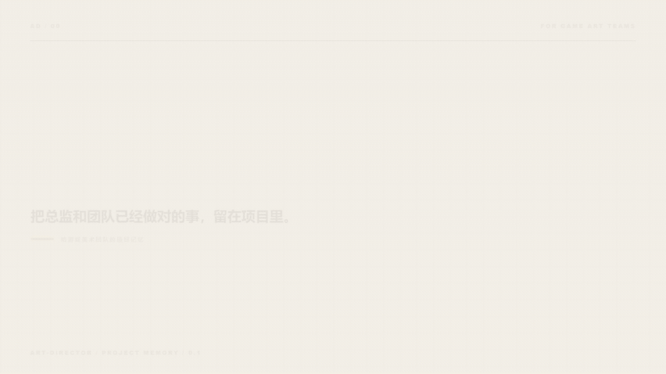

<p align="right"><strong>中文</strong> · <a href="README.en.md">English</a></p>

<picture>
  <source media="(prefers-reduced-motion: reduce)" srcset="assets/readme/art-director-still-zh.png">
  
</picture>

# Art Director

> **总监改过的地方，下一轮不该再从头猜。**

Art Director 帮游戏美术总监和团队记住已经确认的判断。为什么选这张参考、一个角色哪里不能改、这一轮要做什么、最后要交到什么规格，都留在项目里。换了成员、Agent 或会话，也能从同一处接着做。

它适合需要守住独特气质的世界观项目，也适合每周要交付大量角色、场景、棋子、道具、UI 和动效的休闲游戏。画风看起来简单，协作未必简单。素材和参与者一多，小小的偏差就会变成整批返工。

总监继续决定什么是好看。Art Director 负责记住这些决定，把它们带进任务书，并让每次评审留下下一轮用得上的依据。

`Codex` · `Claude Code` · `Cursor` · 其他支持 Agent Skills 的工具

## 安装

```sh
npx skills add https://github.com/NewenergyEric/art-director-skill
```

核心脚本需要 Python 3.10+，不依赖第三方包。只有读取图片像素的检查会可选使用 Pillow。

安装后可以直接这样说：

> 使用 `$art-director`。先看这个项目已经确认的参考图和最近几轮修改，再把画风、角色或道具身份、本轮任务和技术规格分开记录，给团队生成一份可以继续使用的项目包。

[打开完整调用路径](docs/call-flow.html) · [读取 Skill 入口](SKILL.md) · [查看“苔港”演示包](examples/moss-harbor-draft)

---

## 素材越多，越容易各做各的

参考图放满文件夹，团队却不知道哪张管画风、哪张管角色身份。一个问题已经改过三轮，新成员或 Agent 仍从一句模糊提示词开始。消除类和休闲游戏还会同时推进角色、棋子、道具、UI、动效和外包批次，任何一条产线跑偏，返工都会被放大。

Art Director 把容易混在一起的事情分开保存：

| 判断层 | 负责什么 | 怎么进入下一次制作 |
|---|---|---|
| **项目画风** | 全局意图、色彩、材质与跨类别规则 | 每项任务继承 |
| **实体身份** | 角色、道具或场景不能丢失的特征 | 只绑定对应实体 |
| **本次变化** | 动作、表情、镜头和用途 | 只写进本次任务书 |
| **技术规格** | 尺寸、透明、格式和平台条件 | 从实际文件检查 |

同一种画风可以有多个角色，同一个角色也可以换动作。把四件事分开，团队才知道这次该改哪一层、哪些地方已经确认、哪些仍要总监判断。

## 它怎么和团队一起工作

1. **先看已有材料**：把原图、确认样板、现有规范和返工记录放在一起，知道哪些可信，哪些还缺。
2. **把反馈说清楚**：把“感觉不对”落到具体对象、部位、原因和可以怎么改。
3. **留下一份项目包**：`style-pack.json` 保存当前决定，同时生成团队看的 `STYLE.md` 和 Agent 调用的 `SKILL.md`。
4. **给每条产线写任务**：角色、场景、棋子、道具、UI 和动效只拿到自己需要的规则，不把别的角色特征混进来。
5. **先看一小批**：用几个有代表性的素材确认方向，再展开大量制作；技术检查和美术判断分开记录。
6. **让下一轮接得上**：方向变化时保留旧版本、说明改了什么，再把确认后的新判断交给团队。

## 先跑一次真实命令

仓库带有一个完全虚构的“苔港”草案。它故意保留缺失参考、待确认规则和未验证工具，用来展示系统在证据不足时怎样工作。

```sh
python scripts/style_pack.py validate examples/moss-harbor-draft

python scripts/style_pack.py brief examples/moss-harbor-draft \
  --category character \
  --entity lin \
  --task "林蹲在码头修理灯具"
```

建立自己的项目时，从模板开始：

```sh
copy templates\style-pack.template.json my-project\style-pack.json
python scripts/style_pack.py render my-project
python scripts/style_pack.py build my-project --out dist/my-project-0.1.0
python scripts/style_pack.py verify dist/my-project-0.1.0
```

macOS / Linux 把 `copy` 换成 `cp`。发布已确认基线时，为 `validate` 和 `build` 加上 `--release`。缺少真实确认或引用文件时，发布检查会停下来并指出缺口。

## 交付的不只是一份提示词

```text
project-art-style/
├── SKILL.md          # 新会话的调用入口
├── STYLE.md          # 团队可读的规范
├── style-pack.json   # 唯一事实源
├── manifest.json     # 文件清单与内容指纹
├── references/       # 获准共享的参考与依据
├── scripts/          # 包内验证与任务书工具
└── agents/           # Agent UI 元数据
```

项目包可以被复制、归档和验证。成员不需要拿到总监原来的聊天记录，也能知道当前版本、适用范围、确定事项，以及仍需谁判断的问题。

## 两个本地工具

### `style_pack.py` · 项目包生命周期

`validate`、`render`、`build`、`brief`、`verify`、`archive` 和 `diff` 覆盖从工作副本到固定发布快照的完整路径。核心命令只使用 Python 标准库，默认拒绝覆盖已有构建和归档。

### `pilot.py` · 真实材料与试点证据

`intake` 盘点交付材料，`check-image` 从实际图片读取尺寸和透明信息，`summarize` 分开汇总 Agent 模拟与真人团队的 A/B 记录。它不会生成图片，也不会把技术通过冒充艺术通过。

## 已经验证了什么

- 数据结构、交叉引用、路径边界、大小写碰撞、拒绝覆写、构建搬迁和内容指纹有自动化测试。
- 独立使用情境覆盖无工具回退、只拿项目包进行评审，以及从模糊意图建立讨论草案。
- 核心脚本可在 Python 3.10+ 环境运行；图片像素检查在安装 Pillow 时启用。
- 完整开发证据见 [验证报告](docs/validation-report.md) 和 [首轮试点准备](docs/round-01-report.md)。

结构检查通过只说明文件和记录满足契约。真实画风一致性、引擎可用性和团队效率，要用实际项目样板和团队试用继续验证。

## 仓库结构

```text
├── SKILL.md              # 母 Skill 入口
├── agents/               # UI 元数据
├── references/           # 按任务读取的方法
├── templates/            # 风格包、任务卡和评审记录模板
├── scripts/              # 项目包与试点 CLI
├── examples/             # 虚构演示项目
├── tests/                # 确定性测试
├── evals/                # 行为验证与试点记录
├── docs/                 # 协议、研究与验证报告
└── assets/readme/        # README 视觉与可复现渲染脚本
```

## 当前边界

- 不自带图像模型、LoRA 或付费生成服务。
- 不从提示词、文件名或填写的审批人字段推断真实授权。
- 不用一个总分掩盖身份错误、技术失败或未检查项。
- 不把概念图仅凭观感声明为可直接进入引擎的资产。

由 Eric 与 Agents 一起制作。这里保存的是可继续使用的方法，不是一轮对话的结果。
