<p align="right"><a href="README.md">English</a> · <strong>中文</strong></p>

[**Game Dev Skills**](https://github.com/NewenergyEric/NewenergyEric/blob/main/GAME-DEV-SKILLS.md) · [市场研究](https://github.com/NewenergyEric/game-market-intelligence) · [游戏拆解](https://github.com/NewenergyEric/game-reverse-analyst) · [制作管理](https://github.com/NewenergyEric/game-production-manager) · **美术总监**

# Art Director

### 一个团队/项目，一份视觉记忆。

让团队成员与 Agent 按同一套美术判断，为一款游戏制作组件。

## 我和一个美术总监朋友的故事

他是我认识的人里，最像 "艺术家" 的那类人。

做游戏这行，很多人聊管线、工具、效率。但他聊的是 —— 一群人怎么通过一个作品跟彼此说话。他在意的是那个很微妙的 "感觉"。

有段时间我们常约饭、喝咖啡。每次聊到工作，他都在吐槽同一件事：又花了一整天，跟人解释 "我们想要的是什么"—— 跟新来的队友，跟外包，跟越来越听话、却越来越没主见的各种 AI。

我问他：你烦的到底是哪一部分？

他想了一下说：不是他们做得不好，是我每次都要从头讲一遍。这一版讲完，下一版又得重来。而且一旦一个游戏被做成纯 "工程"—— 按流程、按参数、按清单 —— 它原本的艺术性、游戏性、那种好玩，就没了。

这句话我记了很久。

因为我既是游戏爱好者，也是个 FDE—— 我的工作本来就是帮人把一件事 "接起来"。我突然意识到：他的问题从来不是品味。他的品味很好。问题是 ——**他的品味没法交接、没法复用**。它只活在他脑子里，活在他每次重新开口的那几分钟里。

所以我们又聊了几轮、做了几场访谈，把他脑子里那套判断 —— 参考、样板、什么能改、什么不能改 —— 一点点捞出来，变成一份别人、甚至 AI 都能接着用的东西。

它不替他设计，也不替他审美。它只是让他的 "感觉"，第一次有了一个可以被传递的载体。

后来，他真的在用了。

这就是我做一个 "视觉记忆" 的原因 —— 让艺术家的感性，不被工程吞掉。

— Eric

## Art Director 做什么

Art Director 帮主美建立视觉语言、代表样板和各类资产的设计要求。团队成员与 Agent 拿到有版本的项目包，明确各自要做的组件、应该遵守的规则和参考，共同产出风格一致的角色、场景、物品与 UI。个人制作时，也能在不同会话中沿用这些判断。

<a href="https://newenergyeric.github.io/art-director-skill/docs/landing.zh.html#film"><picture>
  <source media="(prefers-reduced-motion: reduce)" srcset="assets/readme/depth-preview-zh.jpg?v=human-story-20261013">
  
</picture></a>

<p align="center"><sub>24 秒：从主美建规范，到成员交付 · <a href="https://newenergyeric.github.io/art-director-skill/docs/landing.zh.html#film">播放清晰版</a> · <a href="docs/assets/motion/depth-showcase-zh.mp4">下载 MP4</a> · <a href="docs/CASE-STUDIES.md">看案例与检查记录</a></sub></p>

## 装好，在你的 Agent 里开始

```sh
npx skills add https://github.com/NewenergyEric/art-director-skill --skill art-director
```

在支持 Agent Skills 的工具里使用，例如 Codex、Claude Code 或 Cursor。把资料放进 Agent 能读取的文件夹，然后直接说：

> 使用 `$art-director`。这是我们的玩法、参考图、已有作品和主美批注。先梳理视觉方向，做一件代表样板；再带我补齐各类资产与组件的要求，打成团队能直接使用的项目包。

已有规范就接着完善，不必重做。绘图与编辑由 Agent 调用当前可用工具完成；Skill 不附带图像模型。

## 让主美的判断更容易被执行

“再简洁一点”“保持一致”需要落到具体画面：改哪里、为什么改、哪些部分必须保留。这次新增三种记录，串起建规范、制作和评审：

| 团队遇到的问题 | 使用什么 | 我们自己的案例 |
|---|---|---|
| 不理解某个美术判断 | 图解判断卡：指出证据、说明原因和调整顺序 | 微波炉如何调整到格子里 |
| 整组既要统一，又要分得清 | 整链／家族设计表：共同规则、可辨差异和组合检查 | 潮灯小镇的四种灯具 |
| 修好一个问题，又破坏了别处 | 返修前后对照：实际改善、保持项复查和未定项 | 补给站的风轮定向返修 |

[看方法与图解案例](references/learning-cases/index.md) · [使用模板](references/visual-judgment.md) · [下载更新包，约 3.6 MB](https://newenergyeric.github.io/art-director-skill/downloads/art-director.zip?v=visual-judgment-20261023) · [SHA-256 校验值](https://newenergyeric.github.io/art-director-skill/downloads/art-director.zip.sha256?v=visual-judgment-20261023)

按任务需要选用，也适用于 UI 状态、组件系列和渠道适配；案例画风与尺寸不作为通用标准。新构建的项目包会携带简版方法。下载包保留精选原创教学案例，排除测试运行产物、临时工作区和构建日志。

## 看三个游戏，如何长出各自的世界

### 潮灯小镇 · 合成与修缮

<table>
  <tr>
    <td width="70%" valign="top"><br><sub><strong>游戏内结果</strong> · 修复并点亮灯塔</sub></td>
    <td width="30%" valign="top"><strong>同一项目包</strong><br> <br>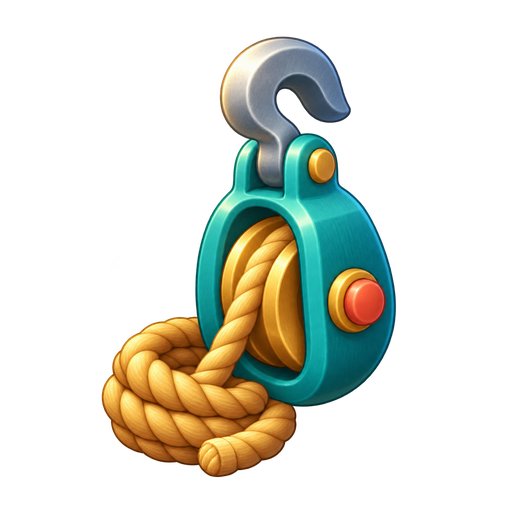 <br><sub>角色 · 灯具 · 材料 · 物件</sub></td>
  </tr>
</table>

用七个合成家族完成修缮订单。**0.6.2 候选版**修栈桥、修灯塔、安装透镜、注油点灯并迎接归船。维修、点灯和招手采用同母版连续局部动作，在受限幅度内保持人物比例、衣服与工具一致。[连续播放与制作复核](docs/TIDEKEEPER-CONTINUITY.zh.md)保留具体修正、运行证据和剩余限制。

[试玩潮灯小镇](https://newenergyeric.github.io/art-director-skill/docs/assets/tidekeeper-playable/play.html)

### 午夜物归原主 · 哥特式解谜冒险

<table>
  <tr>
    <td width="70%" valign="top">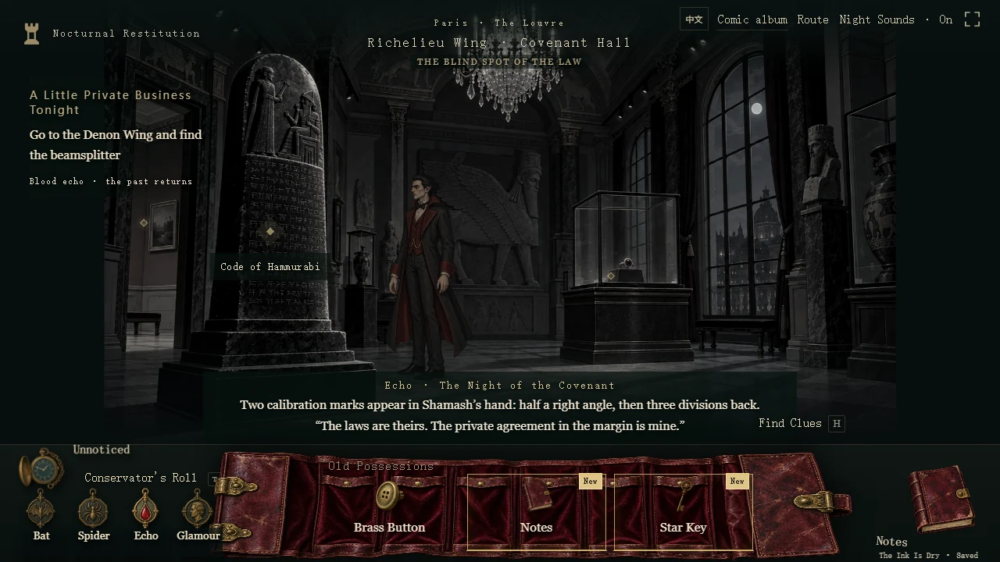<br><sub><strong>游戏内结果 · 巴黎夜访</strong></sub></td>
    <td width="30%" valign="top"><strong>同源组件</strong><br>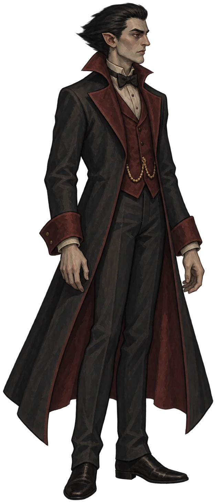 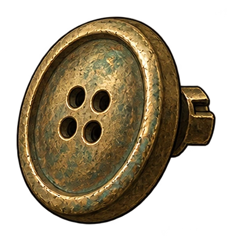<br>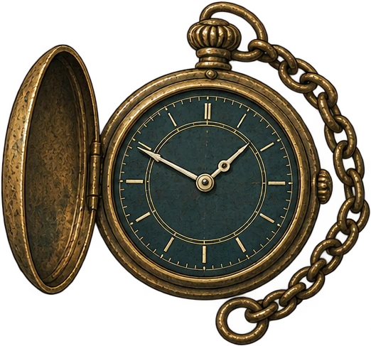<br>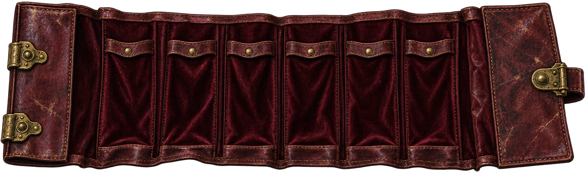<br><sub>角色 · 黄铜道具 · 怀表 · 皮革背包</sub></td>
  </tr>
</table>

**风格化，要落到每一个组件。** 主角的酒红外衣、旧皮革背包、做旧黄铜道具与冷灰展厅，共同构成克制的哥特式手绘世界。角色进入场景，物品进入背包，机关进入操作界面；每个组件都沿用同一份视觉规范。

[看角色、UI 与机关如何保持一致](docs/NOCTURNAL-RESTITUTION.md)

### 暮林守望 · 探索与塔防

<table>
  <tr>
    <td width="70%" valign="top"><br><sub><strong>游戏内结果</strong> · 提灯穿过长夜</sub></td>
    <td width="30%" valign="top"><strong>同一项目包</strong><br>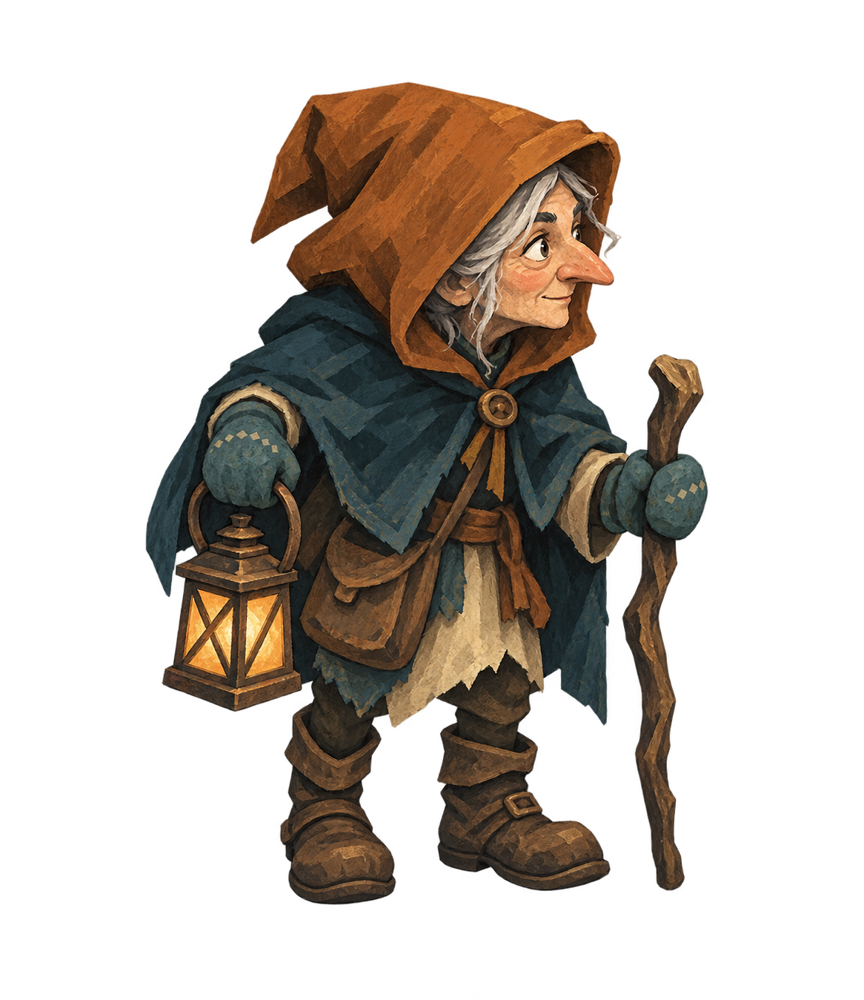 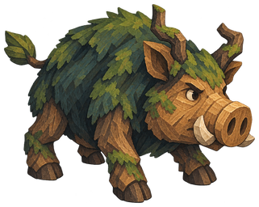<br>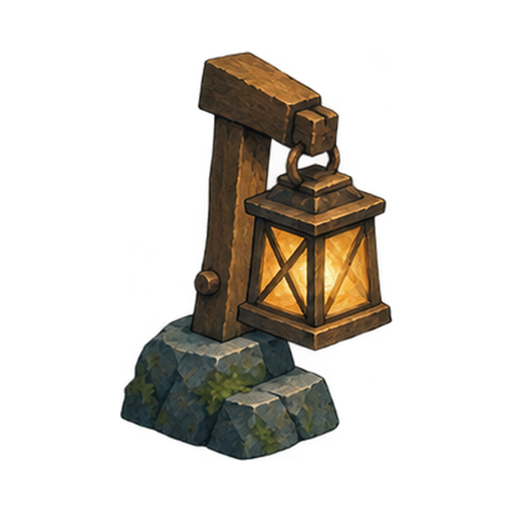 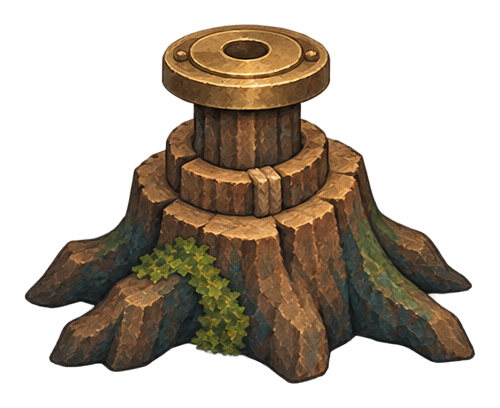<br><sub>守灯人 · 生物 · 灯光 · 防御</sub></td>
  </tr>
</table>

提灯巡林、采集物资、布置防线，在同一张地图守过四夜。移动光源能破除暗甲，燃料、物品与升级影响你的布防。这是从同一份项目包继续制作的 **0.4.0 草案**。

[查看暮林守望英文案例](https://newenergyeric.github.io/art-director-skill/docs/assets/duskwood-watch/index.en.html) · [中文完整试玩（约 33 MB）](https://newenergyeric.github.io/art-director-skill/docs/assets/duskwood-watch/index.html)

三个案例都是原创浏览器游戏原型。《午夜物归原主》已有创作者完整通关反馈；这里展示的是实际画面与组件的一致性，各案例的检查与交付边界另行记录。[查看各 Agent 如何使用 Skill、实际检查与仍存边界](docs/AGENT-ART-TEAM.zh.md)。

<details>
<summary><strong>潮灯小镇的前次交接与 0.3.0 分层交付</strong></summary>

前次交接先建立角色、灯房、灯具与 UI 样板，打包后在新目录开始五个任务：阿澜的新动作、灯房修复状态、L3/L4 灯具和新订单。这是一位 Agent 在隔离目录里的交接自测。

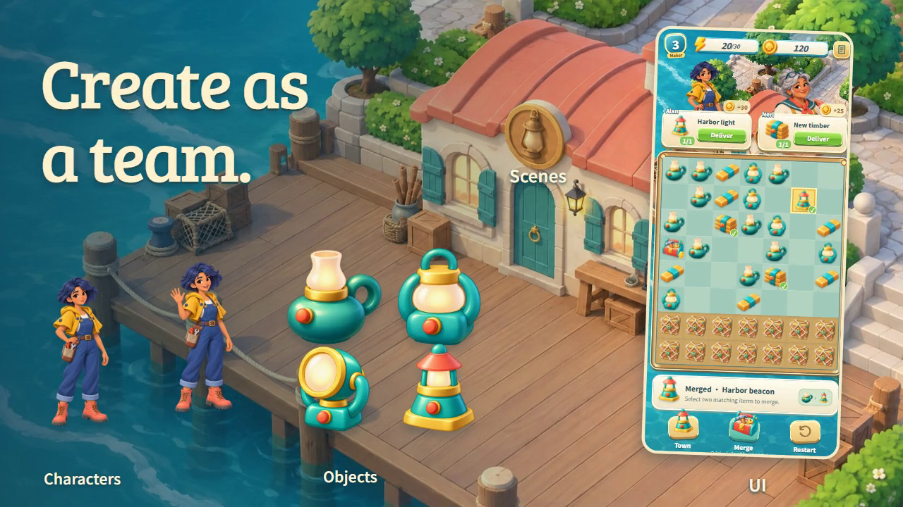

第一次没有全通过。道具和角色能接上，UI 却像空卡片；横版场景放进竖屏，还裁掉了门窗。随后补齐订单角色、资源图标、修缮材料、按钮状态和竖版适配。

<p align="center">
  
  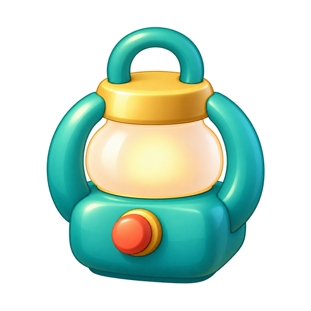
  
  
</p>

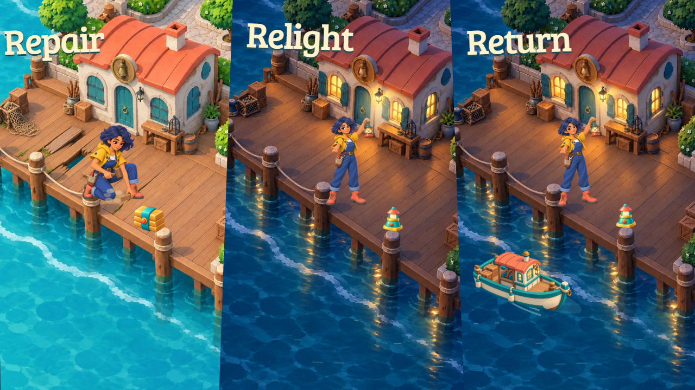

冻结的 **0.3.0** 交付包包含 19 张美术素材、27 项受检查的资产与依赖、5 个场景配方。Compositor 文件格式与换目录交付检查已通过，Mac 原生打开尚未验证。这个存档早于 0.4.0 的八帧修缮动作。

[前次交接与修正](docs/TIDEKEEPER-HANDOFF.md) · [0.3.0 生成与交付记录](docs/TIDEKEEPER-PRODUCTION.md) · [0.3.0 候选交付包](docs/assets/tidekeeper-production/tidekeeper-production-0.3.0.zip) · [此前的画风探索](docs/CASE-STUDIES.md)

</details>

## 从主美的判断，到团队的交付

1. **先整理已有内容。** 参考借鉴哪里、什么不能变，Agent 先写出具体初稿。
2. **用样板确定方向。** 看形状、比例、材料与用途，发现偏差就针对性修改。
3. **把规则带到任务。** 项目包包含规范、样板、参考、版本与交付要求，成员在自己的 Agent 中接着做。
4. **放回使用场景检查。** 不只看单张，还看家族关系、实际尺寸与组合；共性问题回到规范。

你最后交给团队的是五份可读手册、项目专属 Skill 和相关资料，能直接压缩分发。进行中的任务保留原版本，新任务使用已发布的新版本。

成员拿到主美的**完整项目包**后可以说：

> 按这版规范扩展两级灯具，保持镜头、光源和材料，让升级轮廓更清楚。先给我首件，再放回棋盘检查。记录沿用的规则与还没验证的内容。

主美也可以继续说：

> 这张太写实，海面细节抢了修灯动作。只简化表面和背景，保留人物身份、手部接触与空间关系，然后对照原稿复查。

## 两个 Skill，一份项目规范

| 你现在要做的事 | 使用哪个入口 | 得到什么 |
|---|---|---|
| 建立方向、样板、类别与验收要求 | **art-director** | 可分发的专业项目包 |
| 接包后连续生成、组合与交付 | **game-art-production**（可选） | 任务依赖、场景配方、检查记录与分层文件 |

先让首件成立，再组织生产。新制作 Skill 读取同一项目包，能发现缺素材、旧版本和下游依赖变化；不会另立一份画风规范。普通资产交付可以直接使用，可编辑场景则能导出给 [Compositor](https://github.com/robbietilton/Compositor)。

```sh
npx skills add https://github.com/NewenergyEric/art-director-skill --skill game-art-production
```

也可[下载制作 Skill ZIP](https://newenergyeric.github.io/art-director-skill/downloads/game-art-production.zip)，然后说：

> 使用 `$game-art-production`，读取这个完整项目包。继续做修缮动作、傍晚场景和归航效果，先检查同屏比例与接触点，再交付可继续编辑的分层场景。

生成使用 Agent 的图像工具；Compositor 负责图层编辑，不生成图片或播放游戏动画。[查看制作 Skill](skills/game-art-production/SKILL.md) · [样例制作与检查记录](docs/AGENT-ART-TEAM.zh.md)

<details>
<summary><strong>项目包、说明书与安装要求</strong></summary>

核心工具需要 Python 3.10+，使用标准库；像素检查可另装 Pillow。也可[下载当前 Skill ZIP](https://newenergyeric.github.io/art-director-skill/downloads/art-director.zip?v=visual-judgment-20261023)。仅安装通用 Skill，不会自动获得团队私有资料。

[人类上手说明](docs/HUMAN-GUIDE.zh.md) · [Agent 与工程接入](docs/AGENT-GUIDE.zh.md) · [Skill 入口](docs/SKILL.zh.md) · [游戏美术质量流程](references/game-art-quality.md)

[潮灯首件草案](examples/tidekeeper-draft/style-pack.json) · [港湾工作室完整建项示例](examples/harbor-studio-draft/guides/00-index.md) · [品牌与活动设计示例](examples/campaign-studio-draft/guides/00-index.md)

```sh
python scripts/style_pack.py validate examples/tidekeeper-draft
python scripts/style_pack.py build examples/tidekeeper-draft --out NEW_PACK
```

</details>

<details>
<summary><strong>验证与边界</strong></summary>

[当前 CI](https://github.com/NewenergyEric/art-director-skill/actions) · [原创案例证据](docs/CASE-STUDIES.md) · [项目工作流验收](evals/director-workflow-v0.5/acceptance.md)

结构与文件检查不代替艺术判断，视觉自查不代替主美批准。项目包工具在本地运行；使用生成服务时，按宿主工具和你的授权处理资料。

</details>

[告诉我，你在哪一步卡住](https://github.com/NewenergyEric/art-director-skill/issues/new?template=showcase.yml) · [MIT](LICENSE) · [安全说明](SECURITY.md)

由 Eric 与 Agents 一起制作。

## 四个岗位，共同做出值得做的游戏

个人制作者可以轮流承担四个岗位；团队通过同一份资料交接：什么值得做、竞对做了什么、资源和体量如何评估，以及如何创作自己的核心美术。

[岗位如何交接证据、范围与美术资产](docs/WORKFLOW.zh.md) · [四岗位总览](https://github.com/NewenergyEric/NewenergyEric/blob/main/GAME-DEV-SKILLS.md)

| 眼前的问题 | 从这个岗位开始 | 带到下一步的资料 |
|---|---|---|
| 什么值得做？ | [市场研究](https://github.com/NewenergyEric/game-market-intelligence) | 机会比较、来源与验证缺口 |
| 竞对做了什么？ | [游戏拆解](https://github.com/NewenergyEric/game-reverse-analyst) | 规则、实现依据与资产 BOM |
| 做得起，也做得完吗？ | [制作管理](https://github.com/NewenergyEric/game-production-manager) | SOW、工作包、依赖与验收 |
| 核心美术如何建立？ | [美术总监](https://github.com/NewenergyEric/art-director-skill) | 共享规范、代表样板与项目包 |

**个人创作者：** 从当前卡住的问题开始，按需要切换岗位。**团队：** 用实际报告、BOM、工作包和美术规范交接；每一步保留来源、版本与未定项。

这是协作方法，当前没有自动串行执行四个 Agent 的编排器。


