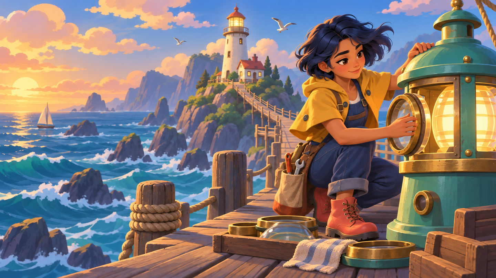
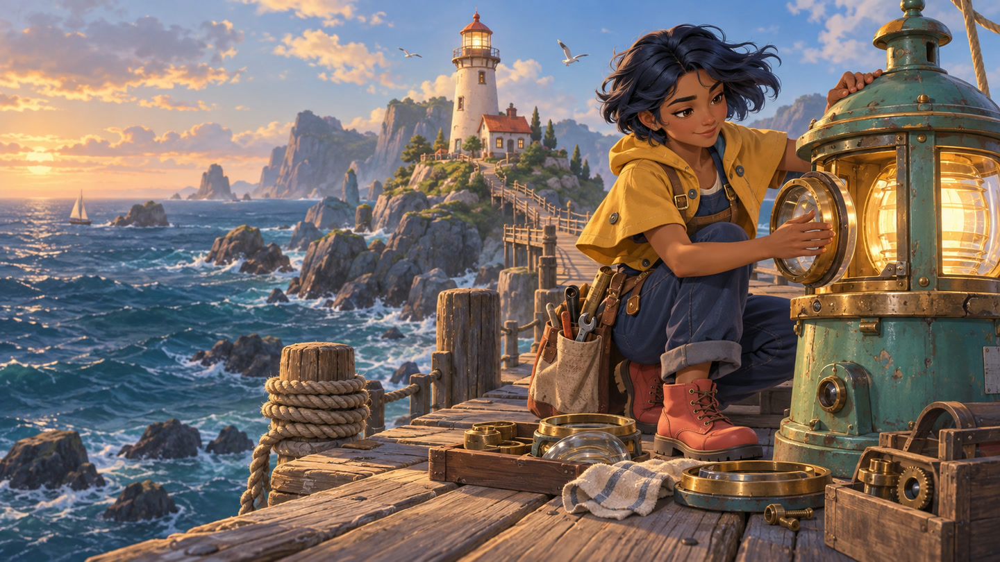
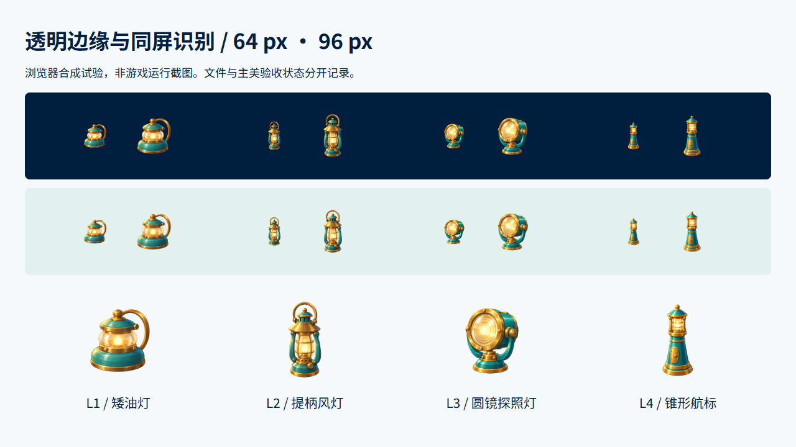
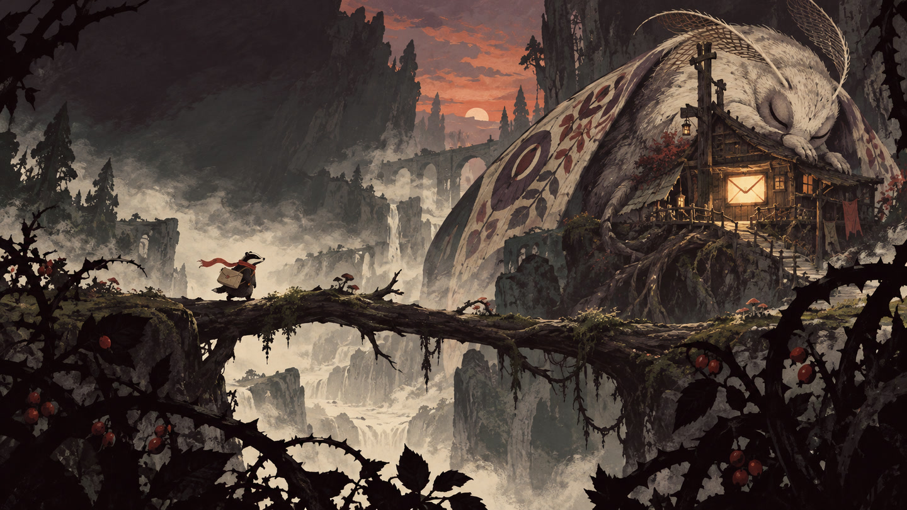
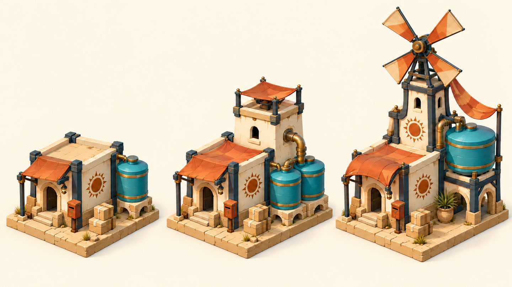

[English](CASE-STUDIES.en.md) · [返回介绍](https://newenergyeric.github.io/art-director-skill/docs/landing.zh.html#cases)

# 三个游戏问题，三种美术解法

**后续完整验证：** [潮灯小镇的四类资产交接](TIDEKEEPER-HANDOFF.md)已补上角色、场景、UI 与合成链的实际续作，保留界面太空和竖屏裁切的失败记录。下方是此前的探索，不能替代新版合成游戏样板。

这些图是 2026-10-13 实际生成和修改的原创候选。我们用它们试验一件事：美术规范能否落实到作品、成套资产和可交接的任务。三组采用不同的形状、材质和空间语言，不能用同一张模板换色替代。

生成、看图自查、文件检查分别记录。当前没有主美批准、真实玩家测试或引擎验收；不把漂亮的概念图当作完成的游戏资源。

## 01 · 潮灯小镇：四个等级，别只换四种颜色

**任务。** 假设一款海港修复与物品合成游戏。灯匠修复航标的主视觉先确定共同语言，再扩展一组能并排辨认的灯具。

**画面判断。** 芥黄披肩与深蓝工装建立角色识别，海绿搪瓷与暖黄铜连接工具、灯具和环境。修灯的手部接触是动作焦点，栈桥把近景工作区连到远处灯塔。第一稿的海面和表面细节太写实，因此修改色面与细节密度，保留人物身份、动作与空间。

查看实际原稿与修改提示

[首稿提示](../examples/game-art-studies/prompts/tidekeeper-keyart.txt) · [定向修改提示](../examples/game-art-studies/prompts/tidekeeper-edit-v2.txt)

提示使用真实图像输入。路径记录用于追踪，不能代替给生成工具附上参考图。

**从样板扩展。** 四张 PNG 分别生成。L1 / L2 使用海港图作风格参考，L3 / L4 再使用 L2 稳定材料语言。等级依次采用矮油灯、提柄风灯、圆镜探照灯、锥形航标；不把颜色差异当作升级关系。

**检查发现与处理。** 首次导出的 L1 / L3 有极低 alpha 像素贴近画布边缘，L2 顶部留白不足。分发版本完整保留源画布，缩放到 384 × 384 后居中放进透明 512 × 512 画布；没有裁掉像素，也没有把低透明度强行清零。现在四件素材最小透明边距分别为 **64 / 68 / 64 / 80 px**，alpha 范围均为 0–255，有可见主体。

看图自查中，圆镜与提柄在 64 px 下仍可区分，但高瘦的 L2 / L4 有效宽度较小；是否需要放大占格比，要在项目真实棋盘和设备上决定。64 / 96 px 是本次试验尺度。上图与影片棋盘是浏览器合成，不是游戏录屏。

**可交接的内容。** [实际规则源](../examples/tidekeeper-draft/style-pack.json)含 6 条候选规则、4 个道具实体、样板、参考角色和未决问题。规则与样板均保留 `proposed` / `candidate`；无人批准时不能成为生产基线。[执行检查记录](../examples/game-art-studies/verification.json)记录打包、搬迁后的完整性和发布拦截。

[四件源提示](../examples/game-art-studies/prompts/) · [文件尺寸、alpha 与哈希](../examples/game-art-studies/assets.json)

## 02 · 荆棘信使：场景漂亮，玩家也要看得懂路

**任务。** 一只系朱红围巾的獾信使，沿树枝桥走向巨蛾栖息的邮局。做一张有目的地和层次的手绘冒险场景。

**画面判断。** 深色前景压住画框，中景路径横贯画面，浅雾把小角色从背景里分离。暖光信封窗是目的地；朱红围巾是角色的局部识别点。墨线、干刷色面与不规则轮廓构成语言，避免仅用“手绘、精美、有氛围”描述方向。

**本次达到什么。** 看图能说明角色、路径、目的地的空间关系；形成与海港样板明显不同的材料和轮廓表达。**尚未证明什么。** 没有碰撞、寻路、交互热点、滚屏分层或玩家视线测试。若作为可玩关卡继续制作，需要单独的层级与遮挡规范。

[完整生成提示](../examples/game-art-studies/prompts/bramble-keyart.txt)

## 03 · 赤砂补给站：升级建筑，保留这个世界

**任务。** 用一个等距视角设计小屋、水塔、风泵三级补给站。增加功能与体量，同时保留入口、奶油色土坯、深青结构和橙色遮阳篷。

**画面判断。** 水储存和动力设备带来结构变化，统一的入口和建造语汇维持家族关系。共用视角让升级幅度可以横向比较。

**真实返修。** 首稿风轮叶片数量不符合要求；第二次仅针对最右侧风轮改为四叶，并要求保留建筑、镜头和排列。最终图中可见四片叶片。其他区域是否达到逐像素不变没有做自动证明。

查看首稿与修改提示

[首稿提示](../examples/game-art-studies/prompts/depot-upgrades.txt) · [风轮修改提示](../examples/game-art-studies/prompts/depot-rotor-fix.txt)

这是一张升级概念板。尚未拆成独立透明建筑、网格、地块占用、3D 模型或引擎预制件；这些须在生产任务里另行生成和验收。

## 把做法带回自己的项目

向 Agent 提供你的玩法、现有作品和参考，先确定一件有代表性的首件。描述可看见的形状、比例、材料、镜头与细节密度；再扩展一组，缩到使用尺寸，放回实际场景。返修只改变有问题的部分，保留输入、原稿与未决问题。

这套步骤已写进 [游戏美术质量方法](../references/game-art-quality.md) 和 [首件记录模板](../templates/game-art-first-article.template.md)。它补充原有的项目包、版本和交接机制；不会把本案例画风强加给别的项目。
