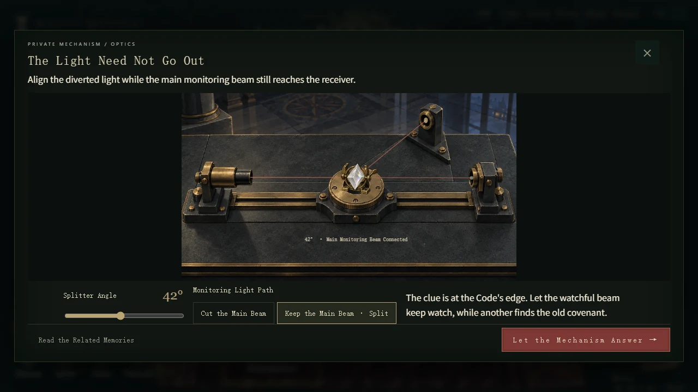
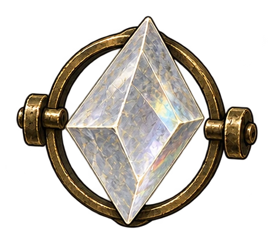
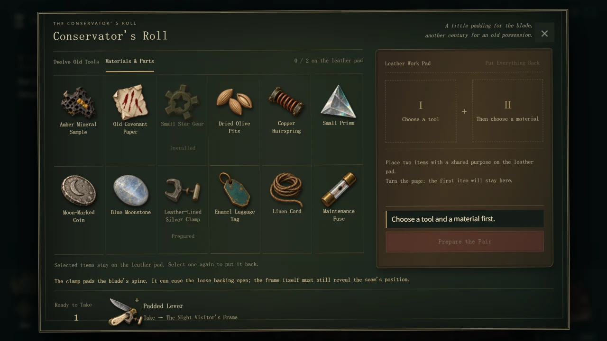

[English](NOCTURNAL-RESTITUTION.en.md) · [返回游戏案例](../README.zh.md#看三个游戏如何长出各自的世界)

# 午夜物归原主：风格化，要落到每一个组件

**一个角色、一件道具、一张界面，都应该像从同一个世界里拿出来。**

这是用 Art Director 工作流持续制作的哥特式点触解谜游戏。它的视觉记忆是酒红衣装、旧皮革、做旧黄铜、冷灰石材与克制的手绘明暗。主美规范同时约束角色身份、场景尺度、物品材质和 UI 组件；制作新内容时沿用这些判断。

## 从单件资产，到真实游戏

  

这些是游戏实际使用的底稿与组件。角色保持同一张脸、酒红衣装和轮廓；运行时再按位置调整姿态、尺度和场景光照。纽扣、怀表与背包上的五金共用做旧黄铜语言，皮革保留褶皱和磨损，不把不同材料都画成同一种光泽。

## 机关与 UI，也在同一个世界里

方解石与黄铜组件进入机关近景，继续沿用展厅中的金属、石材和光影关系。角色场景、近景道具和操作界面分别解决不同问题，仍能接在一起。

工具与材料按自身材质区分，面板、页签、操作状态使用同一套暗底、黄铜细线和纸色文字。规范覆盖组件的用途与状态，交付时再把它们放回实际界面检查。

## 这次案例说明什么

| 范围 | 共享约束 | 在画面中检查 |
|---|---|---|
| 角色 | 身份、衣装、轮廓、细节尺度 | 同一个主角进入不同展厅 |
| 道具 | 做旧黄铜、石材与皮革的区别 | 单件底稿与背包、机关中的同一物件 |
| 界面 | 手绘材质、色彩关系、可读层级 | 皮革背包、怀表、修复卷与机关面板 |
| 组合 | 场景尺度、明暗和使用状态 | 组件实际进入游戏后的整体关系 |

这是“建立规范 → 按规范续作 → 放入场景复核”的案例，不把一张宣传图当作完整交付证据。

版本与素材来源

当前交付为 v31。英文截图来自 v30 的实际通关记录；v31 保留其游戏、美术与 UI。角色与组件从对应源资产导出，按运行登记的区域裁切，并与截图一起做 WebP 压缩；不重绘、不调色。创作者已反馈完整通关，该反馈不等于第三方美术批准或所有设备、生产引擎验收。

[素材来源、区域坐标与哈希](assets/nocturnal-restitution/provenance.json) · [导出说明](assets/nocturnal-restitution/README.md)

