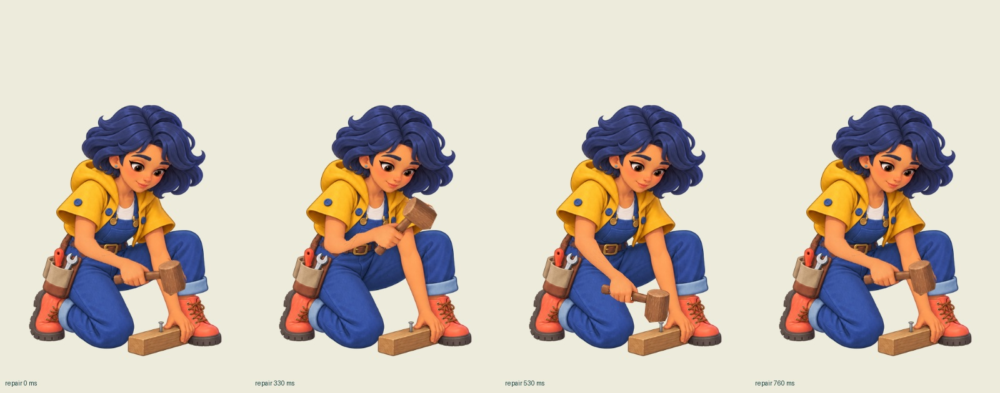
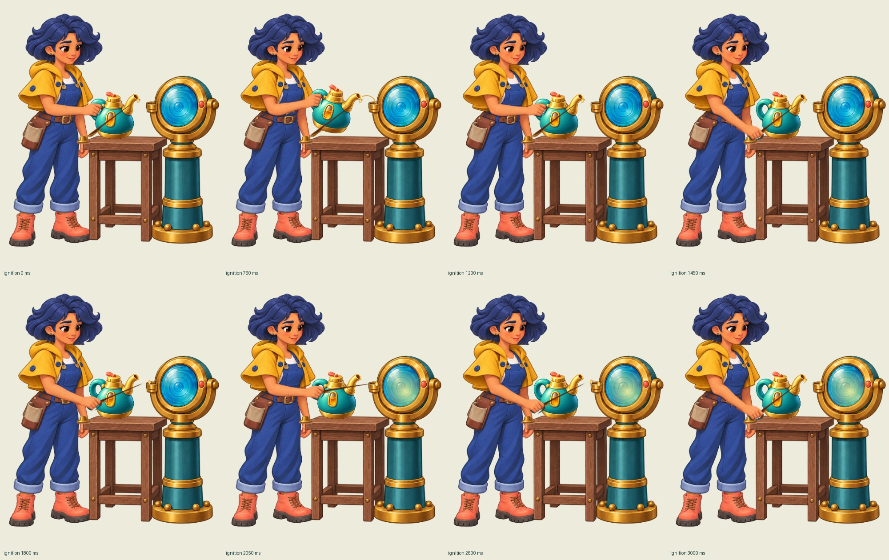
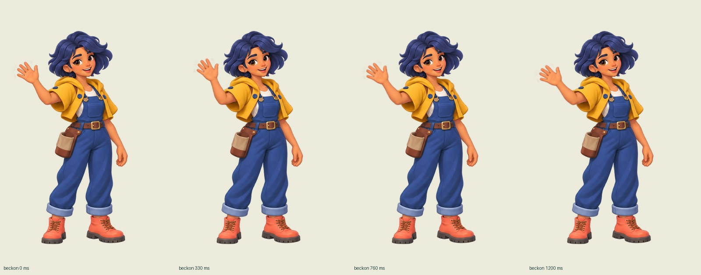

[中文](TIDEKEEPER-CONTINUITY.zh.md) · [Case overview](AGENT-ART-TEAM.en.md)

# Tidekeeper 0.6.2: checking the complete motion

[Play in English](assets/tidekeeper-playable/play.en.html?v=0.6.2) · [Sequential playback, slow motion and phase inspection · Chinese UI](assets/tidekeeper-playable/motion-review.html?v=0.6.2)

Repair, lighting and beckoning now use continuous local motion from fixed source artwork. The correction keeps anatomy, clothing and held tools consistent through the complete action. Seven merge families, sixteen item tiers, two currencies and four construction chapters retain their existing rules and visual direction.

## Failures and corrections

Version 0.6.0 attached separately generated arms to the body, producing incorrect shoulder placement, proportions and sleeve occlusion. The earlier judgment that this was merely stiff motion is withdrawn. Complete character drawings in 0.6.1 restored connected limbs in individual poses, but switching between them still changed hair, clothing, posture and fixture proportions.

Version 0.6.2 borrows the fixed-source, limited-motion and actual-playback approach from Nocturnal Restitution. It uses clean underlays, localized elbow deformation and rigid hands/tools. This is a production-method reference, without copying that game's characters or transferring its acceptance to these actions.

| Action | Complete sequence | Continuity |
|---|---|---|
| Repair, 2.8 seconds | Prepare, raise, strike, recoil and settle; two strikes | Fixed face, clothing and support pose; hand and mallet move together; effects follow contacts at 530/1730 ms |
| Lighting, 3.2 seconds | Pour, set down the can, take the taper, touch the wick and return it | Reuses the board's oil-can artwork; hand, table and holder share transfer coordinates; one instance per prop |
| Beckoning, 5.2 seconds | Small forearm motion, eased start/stop and return | Fixed face, clothes and boots; local elbow transition instead of whole-character translation |

The local-motion implementation also required revision. Moving pieces included trouser pixels; old hand edges left alpha ghosts; an unrestored Canvas clip cut off a tool; a taper handoff jumped about one source pixel. Corrections tightened the moving region, used complete clean underlays, restored drawing state and shared the transfer coordinates. An extra generated underlay changed the composition and scale; it was rejected and retained.

## Playback and verification

The [complete 11.2-second action recording](assets/tidekeeper-playable/evidence/v062/continuous-actions.webm) first plays at native speed, followed by diagnostic inspection. The live inspector uses the same action code. A recording and representative phase captures do not imply independent review of every millisecond.

The complete [Chinese run](assets/tidekeeper-playable/evidence/v062/normal-speed-zh.webm) and [English run](assets/tidekeeper-playable/evidence/v062/normal-speed-en.webm) take 35.889 and 37.045 seconds. Each starts fresh, uses ordinary controls, completes 17 merges and earns 225 coins, without injected resources, skips or accelerated time.

Seven browser scenarios pass 431 checks across both languages, desktop, portrait, landscape, reduced motion, dragging, undo, pause/resume, save/reload and restart. Another [315 raster samples and transfer checks](assets/tidekeeper-playable/evidence/v062/continuity-verification.json) verify selected fixed face, clothing, boot and lamp-base regions. Wick contact error is about 0.091 source pixels. These measurements support particular invariants, not automatic approval of anatomy or natural movement.

[Reproduction scripts](../evals/tidekeeper-continuity/README.md) distinguish normal interaction from deterministic diagnosis. The [import receipt](assets/tidekeeper-playable/evidence/v062/import-verification.json) records source and publication hashes. Integration rewrites two title-translation calls for the static checker without changing their output or the motion; [publication verification](assets/tidekeeper-playable/evidence/v062/publication-verification.json) records another complete playthrough, sequential playback and repository checks.

## Traceable assets and Skill changes

This correction made four generation calls, selecting three new raw images and rejecting one. Runtime uses three fixed action masters, two clean underlays and an existing oil can, with zero newly drawn animation frames. Six older lens-installation poses remain; eighteen timing markers are not new drawings. The [source images, exact prompts, inputs and hashes](assets/tidekeeper-playable/art/actions-v062/receipt.json) distinguish active material from historical attempts.

[Assembly review](../skills/game-art-production/references/assembly-review.md) now covers shoulder/arm structure, sleeve occlusion and truthful claims about 3D sources. [Continuous-action production](../skills/game-art-production/references/continuous-actions.md) covers starts, finishes, loops, prop ownership, alpha ghosts, local joint deformation versus rigid tools, and actual-speed acceptance.

This remains limited local 2D motion with a mostly fixed torso. There is no native 3D model, armature or skinning; lens installation was not converted in this correction. Real phones, production engines and human art-director approval remain unverified. Browser and automated checks do not replace those acceptance steps.
