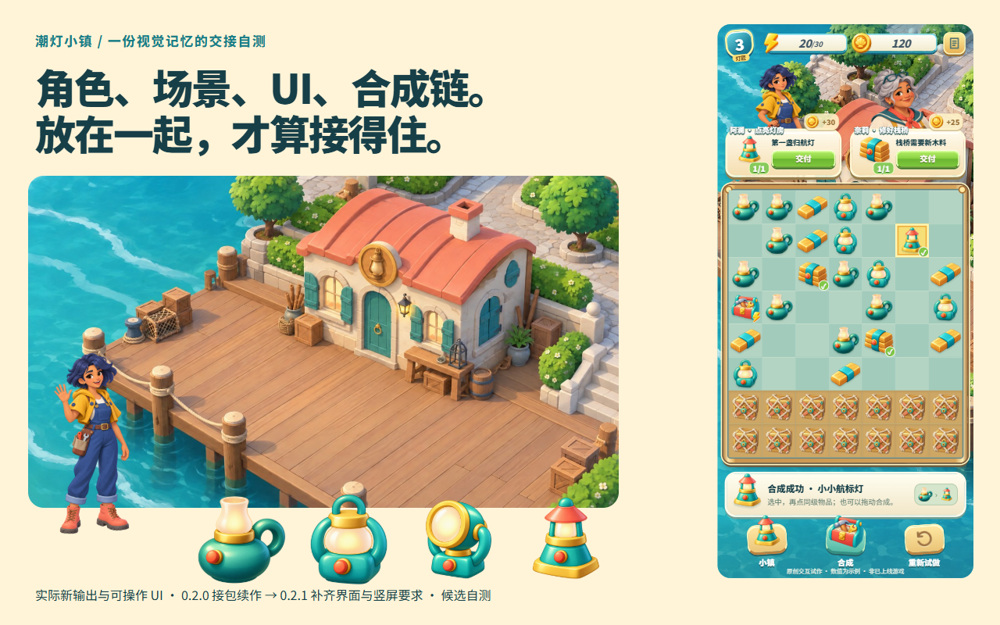
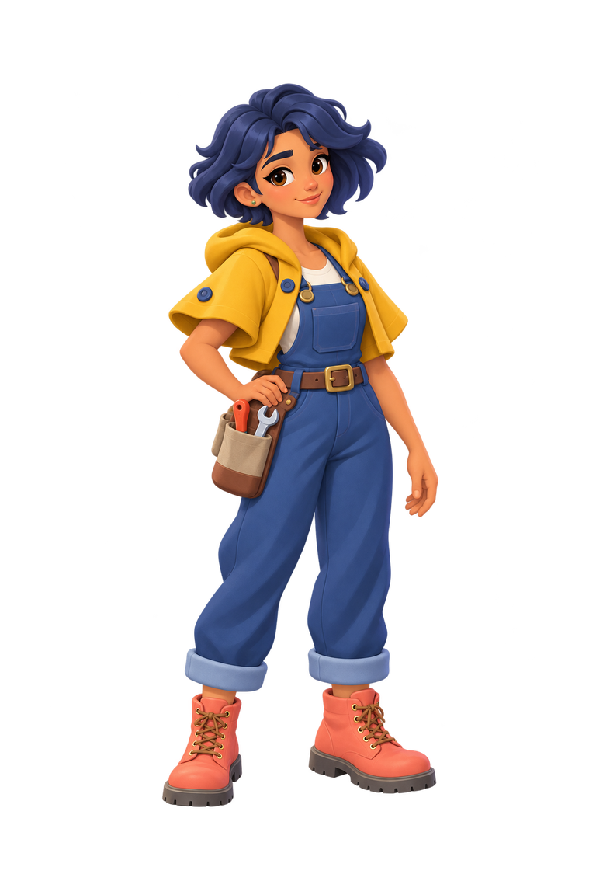
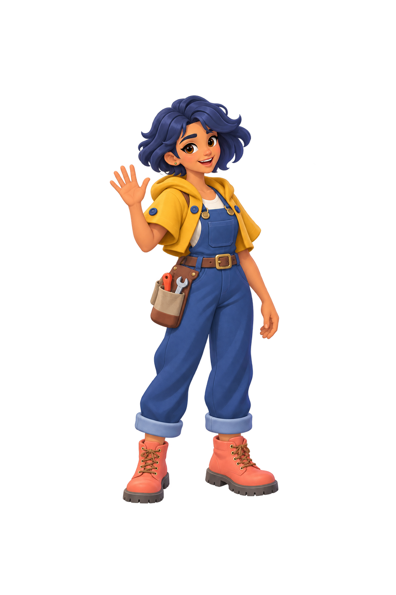
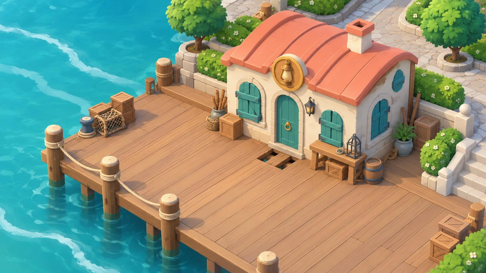
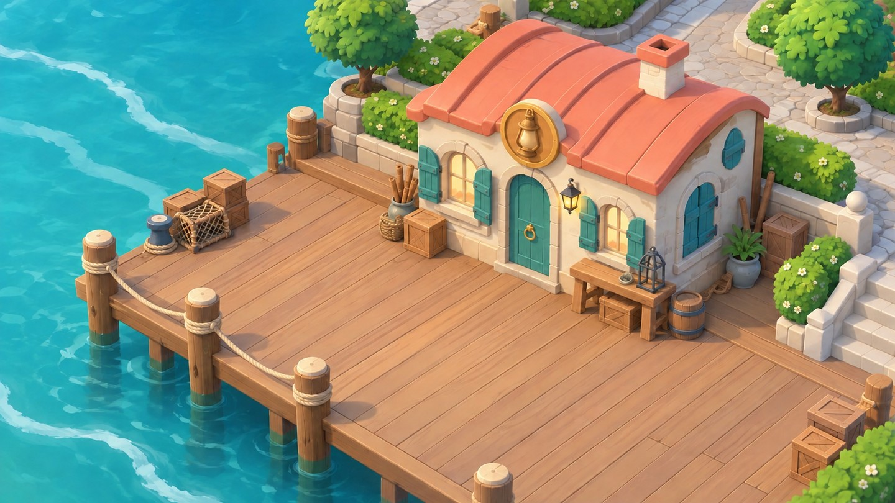
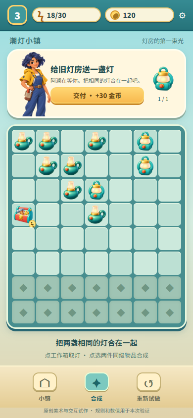
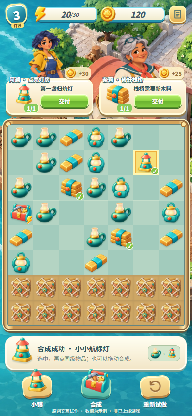
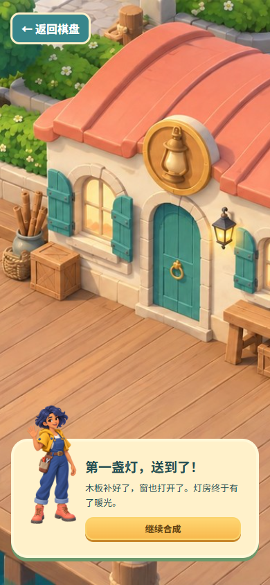
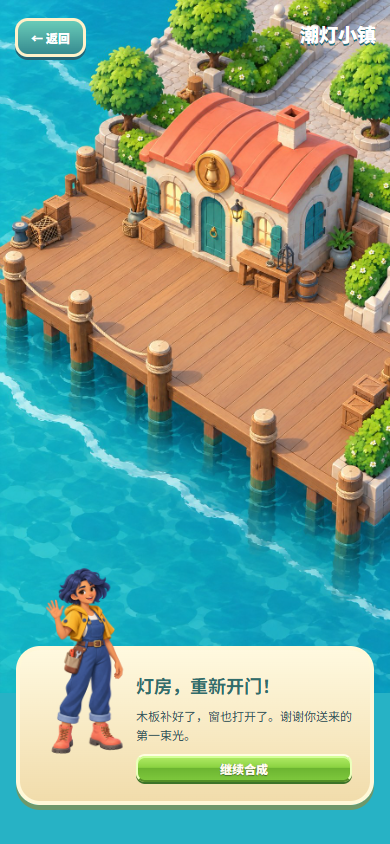
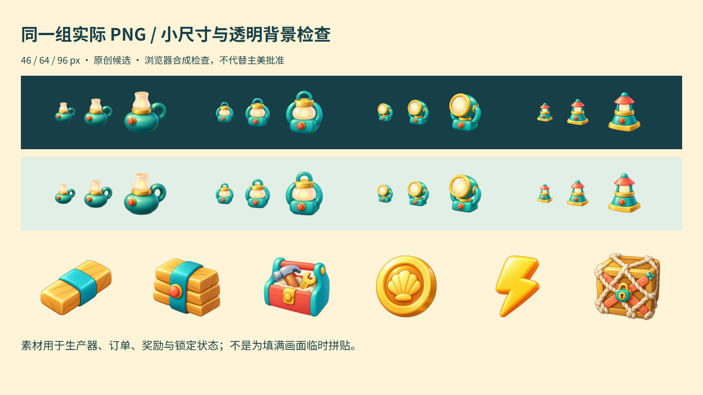

[English](TIDEKEEPER-HANDOFF.en.md) · [返回介绍](https://newenergyeric.github.io/art-director-skill/docs/landing.zh.html)

# 潮灯小镇：一份视觉记忆，怎样交到下一位手里

**结果：角色、场景、灯具的身份和共同语言能够延续；完整交付还需要 UI 美术、状态和视口规范。** 首次交接暴露的缺口，已经回写到项目包和母 Skill。

这是同一 Agent 在隔离目录里的完整交接自测。所有作品和规则都是原创候选；没有声称独立人员盲测、主美正式批准、引擎接入或已经上线的游戏。

## 主美建立了什么

先确定“海港修缮题材的休闲合成游戏”以及资源的实际用途。角色供订单和对话使用，场景供地图使用，物品放进棋盘；宣传图的构图不成为所有类别的要求。

共同语言是饱满体块、宽而柔的高光、海绿、暖木、珊瑚色与暖金色。规则分成四层：项目语言、类别家族、角色/建筑身份、本次允许的变化。阿澜的脸和短发属于阿澜，不应该强加给新角色；灯具材质属于家族，新增 L3/L4 不应丢掉它。

首版带入阿澜身份图、未修复灯房、L1/L2、生产器、可编辑 UI 源码、字体、五份手册与包内工具。[首版实际分发 ZIP（候选）](assets/tidekeeper/tidekeeper-0.2.0-candidate.zip)保留不变，指纹：

`9f24ba82a726248c5d26f9f8c17f218f4c96a29d4fcb4cbef1a83b7283e3cb63`

## 成员拿包后实际做了什么

把 ZIP 解压到新目录，只通过包内工具建立工作区和以下五个任务。四次图像续作使用收到的包中图片作为输入；UI 继承包内源码。没有把旧图改名作为新交付。

| 任务 | 沿用的依据 | 实际变化与结果 |
|---|---|---|
| TK-CHAR-WAVE | 阿澜身份与服装 | 微笑挥手；脸、发块、披肩、连体裤和工具包保持 |
| TK-SCENE-RESTORE | 旧灯房同机位结构 | 补齐门前木板，打开前两扇窗，点亮门灯 |
| TK-CHAIN-L3 | L1/L2 镜头、材料与处理 | 新的圆镜/U 架轮廓 |
| TK-CHAIN-L4 | 同一灯具家族 | 新的短粗航标轮廓 |
| TK-UI-ORDER | 包内 UI、字体与参考 | L4 新订单及缺件/可交付/交付状态，接入新角色和地图 |

## 没通过的地方，怎样改

**首版界面太像资料卡。** 人物小、内容空、资源符号和按钮缺少游戏表达。反馈后补充奈莉、贝壳金币、体力图标、木料两级、锁定货箱；人物站在订单台后，按钮、数值、棋格、状态标记共同使用一套游戏语言。文字保持可编辑。

 → 

**横版场景被竖屏裁掉。** 把横版直接铺满手机画面，会损失需要验收的门窗。增加独立竖版适配，完整显示建筑，并把裁切安全区、角色叠层和显示尺寸写回包里。竖版先适配修复状态，再编辑得到对应未修复状态；不是首次横版输出自然就满足手机要求。

 → 

这些新增资产与规则属于 **0.2.1 候选修订**。首版包与原任务继续冻结，新版用新的 UI 复查任务接收；不回填成“第一次全通过”。[新版规范源](../examples/tidekeeper-handoff/style-pack.json) · [新版候选 ZIP](assets/tidekeeper/tidekeeper-0.2.1-candidate.zip) · [首轮成员交付](assets/tidekeeper/member-deliveries-0.2.0.zip) · [实际提示与输入关系](../examples/tidekeeper-handoff/references/generation-prompts.md)

## 怎么验证的

[打开可操作原型](https://newenergyeric.github.io/art-director-skill/docs/assets/tidekeeper/member-ui.html)：把第 6 格和第 13 格的圆镜探照灯合成，交付两张订单，再看小镇。也可以点工作箱生产、移动物品，或用鼠标拖动同级物品合成。

- 浏览器实测：缺件时不能交付；两件 L3 合成 L4 后可交付；消耗对应库存；120 金币先变 150，再变 175；木料交付把锁定格从 14 个减到 7 个；两张订单都完成才显示开窗、补板、亮灯。
- 同源逻辑检查：同级/不同级、空位移动、棋盘满、体力耗尽、重复交付、锁定格和文字转义。源码是美术原型，数值用于演示。
- 视觉自查：角色并排、场景前后、物品 46/64/96 px、浅深背景透明合成、订单三态与长文案。建筑与物品可辨认；小字体和触摸操作仍需真实手机测试。
- 包验证：构建、压缩、异地解压、仅使用包内工具启动新版任务；未批准候选不能正式发布；被改过的 UI 依赖不能通过完整性验证。

主美视觉批准、玩家识别测试、实际手机、引擎资源拆分/导入、角色绑定、长期数值与经济系统仍是未验证项。图像生成工具未提供可记录的模型版本或种子，记录为未知。

## 这次真正改进了 Skill 的哪些能力

1. 增加[跨类别交接方法](../references/cross-category-handoff.md)，要求“收到的包 + 新任务 + 新输出 + 实际组合”。
2. 把制作与组合检查直接写进生成的项目包手册，成员不必另找母 Skill。
3. UI 检查包含自己的美术资产、可编辑文字、按钮状态、真实密度和操作反馈，不能靠统一色板验收。
4. 加入视口、裁切安全区与角色锚点；把家族共性、实体身份和单次宣传构图分开。

[机器验证记录](../evals/tidekeeper-handoff/verification.json) · [实际生成与交付记录](assets/tidekeeper/production-records.json) · [可复现检查](../evals/tidekeeper-handoff/reproduce.py)

类型观察参考官方 [Gossip Harbor 商店页](https://play.google.com/store/apps/details?id=com.mergegames.gossipharbor)以及用户提供的画面；只借鉴玩法信息层级与美术职责，没有把竞品图片当作本项目资产发布或作为生成输入。
