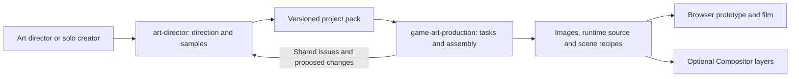

[中文](TIDEKEEPER-PRODUCTION.md) · [Introduction](landing.html#cases)

# Tidekeeper 0.3: scene continuity and delivery

This iteration extends the 0.2.1 character, environment, UI and merge-item direction into connected scenes. It tests character poses, event effects and layered delivery using the same project rules.

[Play the Chinese prototype](https://newenergyeric.github.io/art-director-skill/docs/assets/tidekeeper-production/play.html) · [Candidate delivery ZIP](assets/tidekeeper-production/tidekeeper-production-0.3.0.zip) · [Project rules](../examples/tidekeeper-production/style-pack.json) · [Production plan](../examples/tidekeeper-production/production-plan.json)


## What the prototype does

| Player action | Result | What we checked |
|---|---|---|
| Deliver a bundle of timber | Inventory is consumed, a reward is granted and a crate unlocks; the repair pose and impact dust appear | Feet and knees meet the deck; the tool and dust stay at the intended contact point |
| Deliver an L4 beacon | Day changes to evening; a lantern pose, window lights and water reflections appear | Roof, doors, windows and pier placement; continuity of light and material |
| Welcome the first supply boat | A separate boat enters along the water with a wake; arrival unlocks a one-time reward | The boat avoids land and reads its destination from the scene recipe |
| Continue, restart or skip | Return to merging, restart the sequence or finish an action immediately; reduced-motion mode skips transitions | No duplicate spending or rewards; the hidden board cannot receive keyboard focus |

Five actual image generations added the evening workshop, Alan's repair pose, lantern pose, supply boat and a revised damaged workshop. Together with existing work, the fixture contains **19 art images, 27 assets and dependencies, five static scene recipes and seven story states**. UI text remains editable source. The [generation record](../examples/tidekeeper-production/references/production-prompts.md) preserves prompts, inputs and limits.

## What composition revealed

- The first character placement put the contact point beyond the pier. The character anchor and impact dust moved back onto the deck.
- The damaged building did not differ enough from the repaired one. A targeted edit added missing boards, old shutters and tangled netting while retaining the useful camera angle.
- The boat initially stopped too far from the pier; one promotional crop also cut off its stern. Position and orientation were corrected in the scene recipe, which the runtime now reads directly.
- Rebuilding the board every frame interrupted keyboard focus. Frame updates now affect the scene and progress; board interaction is disabled during the overlay and restored after the state change.
- Linux CI exposed platform-dependent newlines in the frozen JSON manifests. The builder now writes explicit UTF-8/LF bytes. A regression test and rebuilt candidate delivery preserve strict hash verification across Windows and Linux.
- The night image retains the main landmarks but still differs in some stonework, lighting and roof detail. It remains a narrative-transition candidate, not a seamless production-ready environment variant.

The 0.3 fixture uses separate cutout poses and small keyframed transforms, not skeletal animation. Map-facing turns, gait and contact shadows still need project-specific production work. Later animation studies do not retroactively change this frozen fixture's evidence.

## Two Skills, one source of direction



Art Director holds the creative decisions. The production companion organizes execution. Both consume the same project pack; they do not keep separate copies of the palette, identities or style rules. Image generation uses the host agent's available tools.

Promotional artwork has its own [source and reference record](assets/tidekeeper-campaign/README.md). Its layouts and lettering do not alter the game's scene coordinates or turn a promotional composition into a gameplay capture.

## Delivery and Compositor

The ZIP contains the project pack, production plan, scene recipes, five `.comp` files and per-file verification records. Paths remain relocatable. Missing, modified, rejected or wrong-version assets fail verification; exporting candidate material requires an explicit candidate option. Identical inputs preserve layer UUIDs and file contents.

The exporter follows the pinned [official Compositor project format](https://github.com/robbietilton/Compositor/blob/87e2283bae4cea45b857a1bb386f8a56ad4e99b6/docs/project-format.md): version 11 RGBA8 image layers, transforms and ordering. It does not claim automatic import of native editable text, skeletal animation or game logic. UI and animation remain HTML/JS source.

On Windows we checked PNG decoding, UUID filenames, layer positions and ordering, hashes, rebuilding and relocation. **Opening and saving in the native Mac editor has not been tested. Human art-direction review, device checks and engine acceptance remain open.** Platform requirements are documented in the [Compositor repository](https://github.com/robbietilton/Compositor).

To reproduce the technical checks in a fresh directory:

```sh
python evals/tidekeeper-production/reproduce.py --out NEW_CHECK_DIR
node evals/tidekeeper-production/check-scenes.mjs
```

The [verification record](../evals/tidekeeper-production/verification.json) identifies the actual version, assets and exported scenes. Technical success does not establish visual approval. The earlier failures and 0.2.1 delivery remain in the [handoff report](TIDEKEEPER-HANDOFF.en.md).
