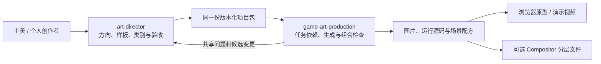

[English](TIDEKEEPER-PRODUCTION.en.md) · [介绍页](landing.zh.html#cases)

# 潮灯小镇 0.3：连续场景与交付验证

**一个团队/项目，一份视觉记忆。** 延续 0.2.1 的角色、场景、UI 和合成链，这次验证连续状态、角色姿势、事件效果与分层交付。不是另换一套美术方向。

[操作原型：修缮 → 点灯 → 归航](https://newenergyeric.github.io/art-director-skill/docs/assets/tidekeeper-production/play.html) · [下载完整候选交付](assets/tidekeeper-production/tidekeeper-production-0.3.0.zip) · [规范源](../examples/tidekeeper-production/style-pack.json) · [生产计划](../examples/tidekeeper-production/production-plan.json)


## 这次做了什么

| 玩家事件 | 实际内容 | 一致性检查 |
|---|---|---|
| 交付一捆木料 | 库存消耗、奖励、货箱解锁；修缮姿势与敲击扬尘 | 脚/膝与甲板接触、工具位置、尘不盖住主角 |
| 交付 L4 归航灯 | 白天过渡到傍晚；举灯姿势、窗灯和海面反光 | 屋脊、门窗、栈桥位置；灯光和材质延续 |
| 招呼第一艘归船 | 独立补给船沿海面入场，尾迹在船下；抵达后领取一次奖励 | 船不穿过陆地，终点读取场景配方 |
| 继续与中断 | 返回合成、重新开始、跳过动作；减少动态模式直接完成 | 不重复扣费/领奖，不让隐藏棋盘接到键盘焦点 |

新增 **5 次实际图像生成**：傍晚灯房、阿澜修缮、阿澜举灯、补给船，以及组合复查后重做的待修灯房。连同已有内容，共 **19 张美术素材、27 项资产与依赖、5 个静态场景配方、7 个故事状态**。UI 文字保持源码可编辑。提示、输入和边界见 [生成记录](../examples/tidekeeper-production/references/production-prompts.md)。

## 组合后发现的问题

- 第一版角色落脚越过栈桥边缘。把角色锚点移回甲板，并同步扬尘接触点；单张图好看不能证明组合正确。
- 修缮前后变化偏弱。以修好后的灯房重新编辑待修状态，集中增加缺损木板、旧窗板和缠网；保留有效机位，不靠标题解释不存在的修复变化。
- 船只最初停得离码头偏远，宣传对照图还会裁掉船尾。调整配方中的位置与朝向；运行时读取同一终点，不再单独写坐标。
- 每帧重建整张棋盘会打断控件焦点。帧更新只处理场景与进度，场景遮罩期间让棋盘失去交互资格；状态改变时恢复合理焦点。
- Linux 流水线发现构建器把 JSON 按系统换行写出，导致 Windows 冻结的 manifest 哈希不同。构建改为显式 UTF-8 / LF 字节，增加跨系统换行测试，并重建候选交付；完整包校验仍保持严格。
- 夜景保留了主要建筑与栈桥关系，但局部光照、石纹与屋顶轮廓仍有生成差异。它适合本次叙事过渡候选，**没有认定为可无缝替换的正式引擎资源**。

阿澜使用独立姿势插演和小幅关键帧，不是骨骼动画；正式地图转面、步态和接触阴影还需要游戏项目的具体规格。这里记录实际边界，不把文件检查当成主美验收。

## 两个入口怎样接

宣传画面另做一轮商店图表达：参考官方 Google Play 页面的大字、角色前景与场景叙事，重排项目素材，并实际生成一件独立透明标题牌。标题保留可编辑源码；这不改变游戏运行时的场景坐标，也不把宣传合成图称作游戏截图。[元素、提示与参考来源](assets/tidekeeper-campaign/README.md)随仓库提供，方法已加入母 Skill 的[宣传画面指南](../references/game-presentation.md)。



母 Skill 保管判断，制作 Skill 组织执行。二者不会各存一份颜色、角色身份和规范；项目包是唯一依据。生成模型仍由宿主提供，脚本没有伪装成图像生成服务。

## 实际交付与 Compositor

交付 ZIP 含完整项目包、生产计划、场景配方、5 个 `.comp` 和逐文件校验记录。资产路径可迁移；缺失、改变、拒收或旧版本会使检查失败；候选需明确允许后才能导出。相同输入保持图层 UUID 和文件内容可复现。

依据 [Compositor 官方格式](https://github.com/robbietilton/Compositor/blob/87e2283bae4cea45b857a1bb386f8a56ad4e99b6/docs/project-format.md)，导出基础 version 11 的 RGBA8 图片图层、前后顺序与变换。没有声称原生文字、骨骼动画或游戏逻辑可以自动导入。界面与动效保留为 HTML/JS 源码。

当前电脑为 Windows：已验证 PNG 解码、UUID 文件名、图层顺序/位置、哈希、重建和换目录交付；**Mac 原生打开与回存未测，真实主美、真机和引擎验收待做**。Compositor 当前要求 macOS 26、Apple Silicon，见[官方仓库](https://github.com/robbietilton/Compositor)。

Agent 可从新目录复现：

```sh
python evals/tidekeeper-production/reproduce.py --out NEW_CHECK_DIR
node evals/tidekeeper-production/check-scenes.mjs
```

[机器检查记录](../evals/tidekeeper-production/verification.json)记录实际包版本、资产数、文件数和每个导出场景，不把技术通过升级为审美批准。前次交接的失败样例与 0.2.1 包保留在[原记录](TIDEKEEPER-HANDOFF.md)。
