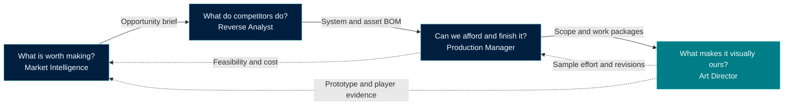

# Four roles. One game worth making.

[中文](WORKFLOW.md)

For a solo creator these are four hats; for a team they are four accountable roles. They share decisions and versioned evidence rather than relying on the original chat. Start at the question you have; return to earlier decisions when evidence changes.

| Question | Role | Concrete handoff | What comes back |
|---|---|---|---|
| What is worth making, for whom, and where? | [Market Intelligence Director](https://github.com/NewenergyEric/game-market-intelligence) | Product-route comparison, audience/IP/region/language/payment evidence, open tests | Prototype response, cost assumptions and new market evidence |
| What do competitors actually do? | [Game Reverse Analyst](https://github.com/NewenergyEric/game-reverse-analyst) | Experience loops, progression/economy rules, content cadence, asset-family BOM, implementation evidence where useful | Questions about differentiation, missing content and reusable structure |
| Can we afford it and finish it? | [Game Production Manager](https://github.com/NewenergyEric/game-production-manager) | SOW, base/variant/state quantities, capacity and cost scenarios, dependencies, versioned work packages and acceptance | Actual throughput, revisions, bottlenecks and scope changes |
| What makes it visually ours? | [Art Director](https://github.com/NewenergyEric/art-director-skill) | Original visual direction, representative characters/scenes/UI/items, design rules, sample reviews and a distributable project pack | Sample quality, style decisions, production effort and revision cost |

## A concrete handoff

“A delivered item changes a neighborhood corner” starts as an experience proposal. Market research tests audience, region, monetization and differentiation. Competitor analysis identifies state transitions and content families. Production management separates order rules, UI states, scene states, localization, QA and integration, with explicit unknowns for cost and capacity. Art Director establishes original character, environment and UI samples, then turns confirmed choices into the project's visual rules.

Use the first representative assets and prototype results to revise the BOM, effort assumptions and commercial hypothesis before scaling. Engineering implements and validates those decisions alongside art and content production.

The shared handoff carries: **question → evidence/version → proposed or confirmed decision → constraints → asset/work scope → owner → acceptance → feedback**. A diagram describes the collaboration; it does not claim an automatic multi-agent orchestration system.

## Editable relationship diagram

The diagram below records the same responsibilities and feedback as the shared family graphic. The roles can exchange versioned handoffs through the user’s agent; the graphic does not imply an automatic dispatcher.

