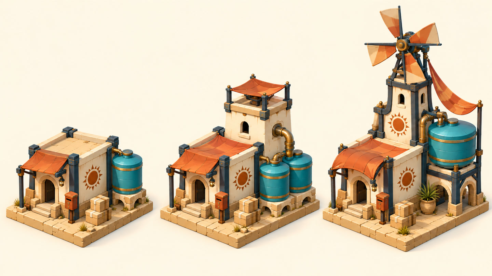

# 返修前后对照：赤砂补给站的风轮

记录 `DEPOT-ROTOR-01`，2026-10-23 依据 2026-10-13 的实际生成图、编辑提示和自查记录整理。范围是一张三级建筑概念板中最右侧的风轮；不是完整建筑资产的生产验收。

| 修前概念板 | 定向修改后的概念板 |
|---|---|
|  |  |

**看哪里。** 最右侧建筑顶部的风轮。需要检查叶片数量、连接与可辨性；同时回看下方塔身、其他两级建筑和整体镜头。上表适合定位，细节请打开实际图片查看。

| 项目 | 本轮记录 |
|---|---|
| 原问题 | 历史记录指出首稿风轮叶片不符合该任务要求 |
| 成因假设 | 局部结构没有遵循任务规定；没有证据断言具体模型内部原因 |
| 本轮操作 | 以实际首稿作图像编辑输入，要求最右侧风轮改为四叶，保留建筑、相机和排列 |
| 实际结果 | 修改后可见四片叶片；这是看图自查，不是工程结构或主美批准 |
| 保持项 | 奶油色建筑、深青结构、橙色篷布，以及三级横排和主要入口关系 |
| 比较条件 | 已有两张 1440 × 810 分发 JPEG，同一整板视图；不是分层源文件或逐像素锁定结果 |

| 复查范围 | 观察与结论 | 未覆盖范围 |
|---|---|---|
| 本轮风轮目标 | 修后可见四片叶片；目标的视觉自查支持该项改善 | 机械可行性和运行旋转未测 |
| 其他区域 | 三级排列、主要建筑结构和主题色仍可对应；地面等局部细节并非逐像素相同 | 不能把“要求保留”写成“其他像素完全不变” |
| 家族关系 | 入口、建筑语汇与增设功能仍可一起讨论 | 独立建筑导出、正式地块占用和引擎集成未做 |
| 决定状态 | 当时保留此稿作为修改后的概念展示 | 没有真实主美批准或生产验收记录 |

**可复用的判断。** 返修应指定问题区域、允许变化和保持项，并在实际输出上检查两者。四叶仅为这项任务的要求；不能成为所有风轮、等级链或风格化建筑的规定。

**下一次怎样用。** 若修正 UI 图标数量，除了检查数量还要回看文字、间距和状态；若修改角色挂件，还要回看身份和接触结构。复查范围来自真实依赖，不必重测无关素材，也不能只检查改动位置。
