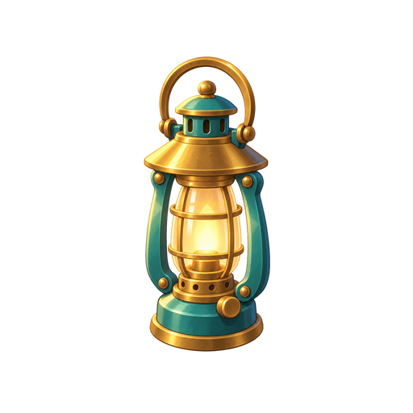
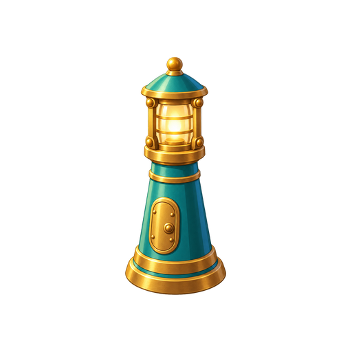

# 整链设计表：潮灯小镇的四级灯具

记录 `TIDEKEEPER-LAMPS-01`，2026-10-23 依据 2026-10-13 的原创候选素材与检查记录整理。此表是事后补写的教学示例，不冒充当时已批准的生产计划。

关系为探索中的 **L1 → L2 → L3 → L4**。主题是海港照明；共同继承候选的海绿搪瓷、暖黄铜、灯光和圆润体面。等级差异主要来自功能和轮廓，而非一组换色图。四级数量与材质均为本案例选择。

| L1 · 矮油灯 | L2 · 提柄风灯 | L3 · 圆镜探照灯 | L4 · 锥形航标 |
|---|---|---|---|
|  |  |  |  |

| 成员 | 身份与主要识别线索 | 继承／差异 | 风险与复查对象 | 已有证据／状态 |
|---|---|---|---|---|
| L1 | 低矮圆底与集中灯芯 | 继承材料；建立低矮基础轮廓 | 小尺寸时灯芯和底座是否挤在一起 | 独立 PNG；候选 |
| L2 | 细长灯身和上方提柄 | 延续照明与材料，突出便携结构 | 提柄是否可辨；与同样高瘦的 L4 比较 | 独立 PNG；候选，有效宽度仍需检查 |
| L3 | 大圆镜与侧向灯体 | 用定向照明改变主轮廓 | 圆镜和支撑是否分开；与 L1 的圆形结构比较 | 独立 PNG；候选 |
| L4 | 收束塔身、顶部灯室 | 由手持尺度转为航标语义 | 与 L2 的高瘦轮廓是否混淆；塔身细节在使用尺度能否支持身份 | 独立 PNG；候选，有效宽度仍需检查 |

**按风险选样板。** 如果继续这个家族，优先复用 L1 检查最简成员，以 L2 / L4 检查高瘦且易混淆的一对，另查 L3 圆镜的差异。这里给出的是后续建议，不表示所有检查已经完成，也不要求其他项目固定检查四件。

**实际做过什么。** 四张素材分别生成；原记录说明 L1 / L2 采用海港图作风格参考，L3 / L4 再借 L2 稳定材料表达。分发加工保留完整源画布，不以裁掉边缘像素解决留白。保存的浏览器合成在当时使用 64 / 96 px 试验尺度；当前文档缩放不代表实际像素显示。

**观察与边界。** 历史自查认为提柄与圆镜在试验小尺寸下仍可区分，同时指出 L2 / L4 有效宽度较小。当前图能支持同材料语言与轮廓差异的讨论，不能证明真实棋盘混排、玩家识别率或手机运行已通过。没有主美批准；不能把材质光泽直接继承到要求低反光的其他项目。

**整组继续检查。** 在本项目真实背景和密度下比较 L2 / L4，并与其他家族混排，必要时调整主体尺度或识别结构，再复查相邻关系。依赖实际问题决定改动，不能统一拉伸所有高瘦物件。

**迁移到其他类别。** UI 家族把“等级”换成真实状态含义和转换关系，记录状态差异与页面组合；渠道系列记录裁切、内容优先级和重排。无需给这些关系添加等级，也不强制它们使用灯具的轮廓或材料。
