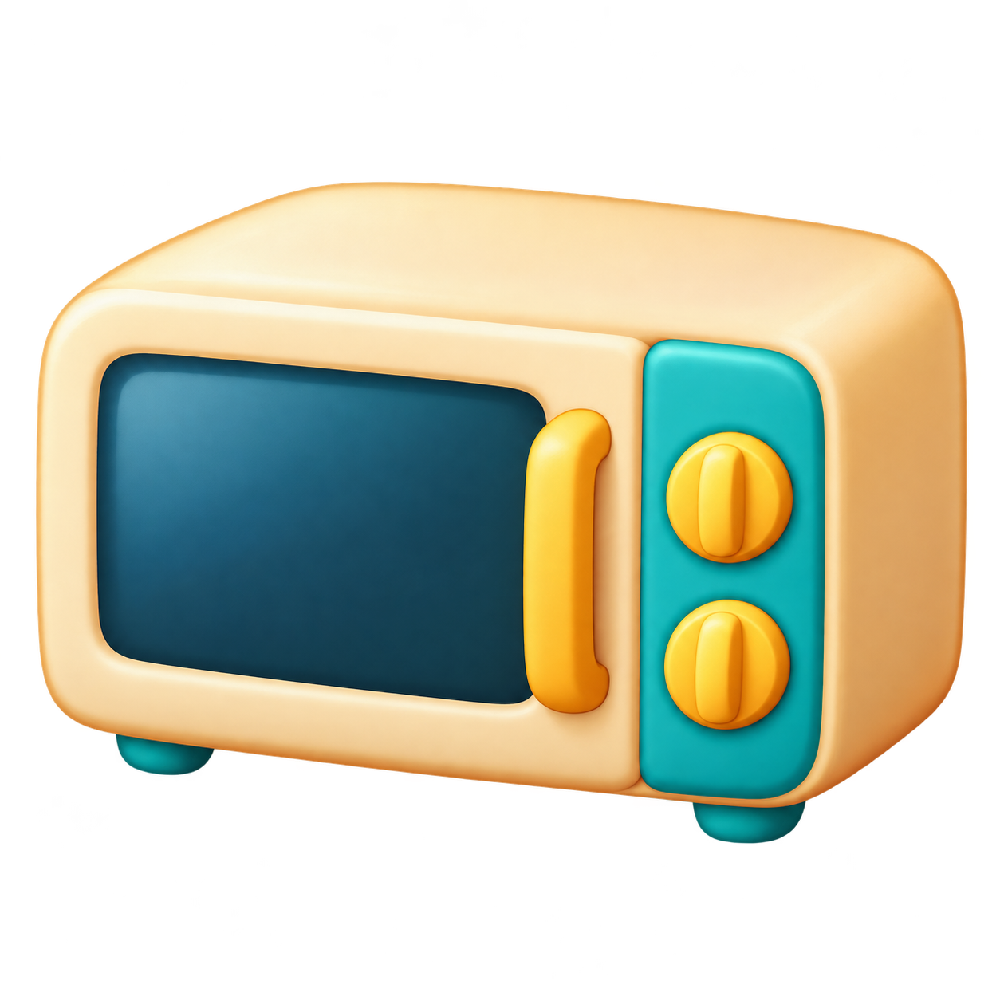
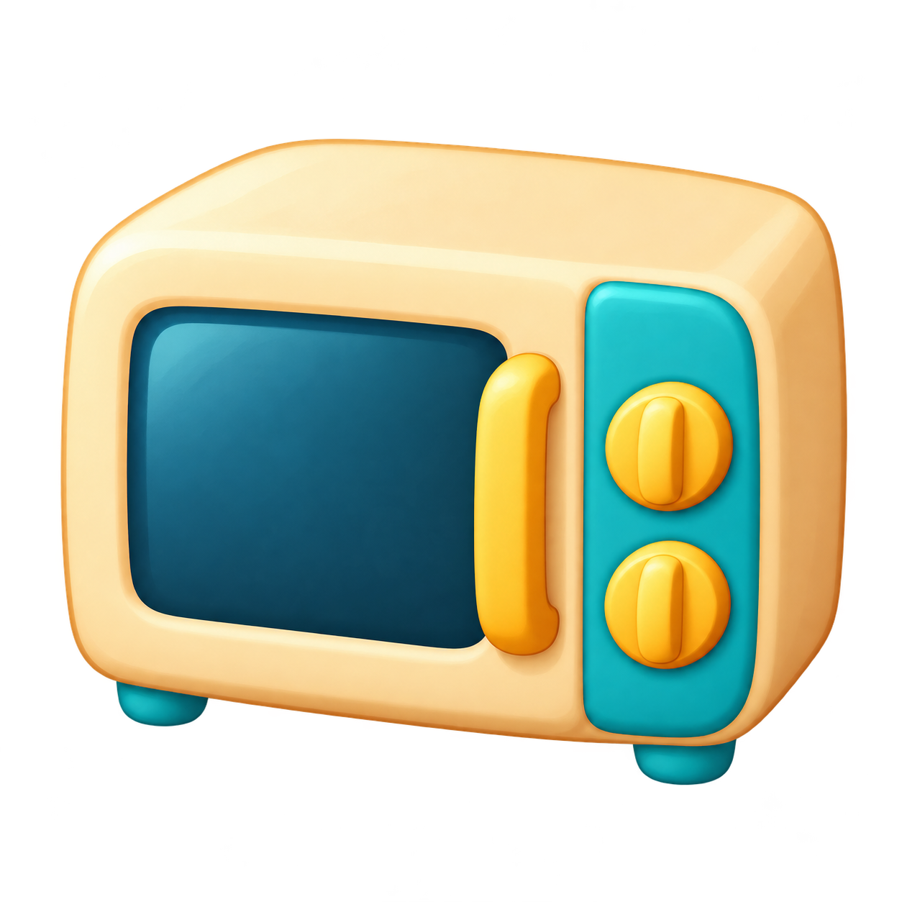
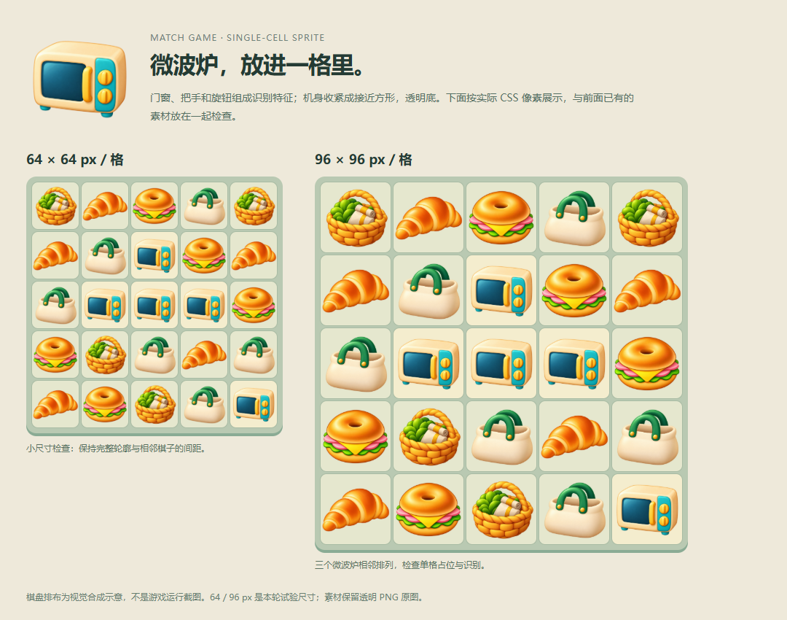

# 图解判断卡：微波炉要作为一个棋子被读懂

记录 `MICROWAVE-USE-01`，2026-10-23 依据 2026-10-20 的实际任务补写。范围是这一个候选资产的格内使用；性质为制作经验与视觉自查，不是已批准画风规范。历史项目草稿版本为 0.2.0。

| 修前：单张造型 | 修后：格内用途的候选 |
|---|---|
|  |  |

打开原图可看完整画布；上表随阅读器缩放，只用于造型比较，不能当作实际使用尺寸证明。

| 看哪里 | 实际观察 | 对本轮制作的意义 |
|---|---|---|
| ① 机身外轮廓、顶部与右侧 | 修后机身更紧凑，可见侧面收窄 | 优先调整使用比例；“微波炉”这个名称本身不能决定是道具还是棋子 |
| ② 深色门窗与竖把手 | 两版均保留主要功能结构 | 简化时保留识别，不靠增加食物、标签或电缆说明是什么 |
| ③ 右侧两个旋钮 | 修后仍为上下两个明显色块 | 保持当前设计特征，并在小尺寸检查是否还能分开 |

**反馈与任务转向。** 用户先要求做一个新的微波炉，随后明确“是消除游戏，要能放到格子里”。制作范围收敛为这个新对象，原食品与篮子的扩量清单停止。

**判断与调整顺序。** 先按用途绑定棋子类别；再收紧机身比例、减少顶部和侧面面积；保留奶油色机身、青色门区、黄色把手和双旋钮。最后把实际文件放入格子，并检查相邻重复与混排。上述配色和结构属于这个候选，不是所有电器的统一规定。

**必须保留。** 门窗、把手和双旋钮的身份；完整轮廓与透明交付画布。减少表面细节时仍需清楚的主次与体积，不能只把一切抹平。当前修后图仍有明显高光，不能据此宣称“去光泽”或所有简化要求都已通过。

**已有证据。** 历史记录保存了实际图像编辑、返回文件和浏览器截图。上一版图用于保留对象与配色，原用户参考用于画风约束；原用户参考没有收进本教学包。工具未返回模型版本和 seed。上述棋盘在当时以 64 / 96 CSS px 试验格检查；这里展示的是截图，阅读器可能再次缩放，不能当作当前设备实测。历史看图自查记录了完整轮廓、关键部件和重复相邻间距；混排对象也都是当时的候选。

**保留未定项。** 这是静态合成，不是游戏运行；最终引擎、设备、导入规格和主美对整组的批准均未记录。修后图是 1254 × 1254 RGBA，文件测量只描述这个输出，不构成目标尺寸或占格比例标准。原始记录没有同条件的修前棋盘，因此不宣称格内辨识提升了某个百分比。

**适用边界。** 可借鉴“先用途、后结构、再组合检查”；不能推广成所有对象都要接近方形。场景道具、多格物件、写实产品等须按自己的用途检查。该卡的比较图可以作为局部教学证据，尚不能作为新项目的整体画风依据。
